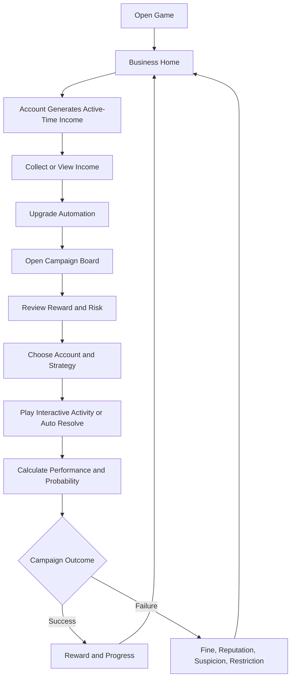

# GAME DESIGN DOCUMENT (GDD)
# MENJADI BUZZER — v1.3 (Semi Idle Prototype Specification)

**Status:** Draft Spesifikasi Prototype  
**Berdasarkan:** GDD v1.0, v1.1, dan v1.2 Idle Revision  
**Fokus:** Satu vertical slice yang membuktikan passive income + automation + campaign risk-reward  
**Platform:** Browser Game  
**Mode:** Single-player  
**Offline Earnings:** Tidak termasuk prototype

---

# 1. TUJUAN PROTOTYPE

Prototype v1.3 menguji apakah kombinasi Semi Idle dan kampanye aktif terasa menarik. Prototype tidak bertujuan membangun seluruh game. Pemain harus dapat melihat akun menghasilkan uang secara otomatis ketika game berjalan, meningkatkan pendapatan melalui otomasi, lalu mengambil kontrak kampanye dengan keputusan dan risiko.

## 1.1 Pertanyaan yang Harus Dijawab

1. Apakah passive income mudah dipahami dan terasa memberi progres?
2. Apakah upgrade automation memberikan motivasi investasi yang jelas?
3. Apakah pemain memahami trade-off reward dan risiko kampanye?
4. Apakah aktivitas interaktif terasa menyenangkan dan berdampak?
5. Apakah hasil kampanye terasa adil meskipun ada unsur probabilitas?
6. Apakah pemain ingin kembali mengelola akun setelah kampanye selesai?

## 1.2 Batasan Prototype

**Termasuk:**
- Satu karakter/avatar sederhana.
- Satu akun media sosial.
- Pendapatan pasif saat game terbuka.
- Followers dan performance sebagai faktor pendapatan.
- Upgrade automation sederhana.
- Satu daftar kontrak kampanye contoh.
- Pemilihan strategi/intensitas.
- Satu atau dua mini-game.
- Probability-based campaign resolution.
- Reward, denda, reputasi, suspicion, dan restriction dasar.
- Finance/transaction history sederhana.
- Local save/load.

**Tidak termasuk:**
- Offline Earnings.
- Multi-account penuh.
- Staff/agency management.
- Game Over lengkap.
- Backend/login/multiplayer.
- Shop lifestyle lengkap.
- Saham, kendaraan, properti, travel, photo mode.

---

# 2. PLAYER STARTING STATE

Nilai di bawah hanya contoh awal untuk prototype dan harus dapat diubah melalui konfigurasi.

| Parameter | Starting Value |
|---|---:|
| Career Level | 1 |
| Money | 500 |
| Reputation | 0 |
| Career XP | 0 |
| Account Count | 1 |
| Followers | 1.000 |
| Performance | 50 |
| Account Suspicion | 10 |
| Automation Level | 0 |
| Account Status | Normal |
| Completed Campaigns | 0 |

Nama akun dan platform fiktif dapat menggunakan placeholder dari dokumen terdahulu, misalnya `@KilatDaily` pada platform `Chirper`, sampai identitas final disetujui.

---

# 3. PROTOTYPE CORE LOOP



## 3.1 Urutan Interaksi

| Step | Player Action | System Response |
|---|---|---|
| 1 | Memulai game | Memuat atau membuat state pemain |
| 2 | Melihat Home | Menampilkan saldo, income rate, akun, dan campaign |
| 3 | Membiarkan game berjalan | Passive income bertambah berdasarkan elapsed time |
| 4 | Membeli automation upgrade | Mengurangi saldo dan meningkatkan income rate |
| 5 | Membuka Campaign Board | Menampilkan kontrak tersedia |
| 6 | Membuka brief | Menampilkan reward, bonus, difficulty, dan risk |
| 7 | Menerima kontrak | Membuat campaign session |
| 8 | Memilih strategi | Menyimpan keputusan dan modifier |
| 9 | Menjalankan mini-game/auto resolve | Menghasilkan execution quality atau auto score |
| 10 | Resolve campaign | Satu kali perhitungan outcome dan consequences |
| 11 | Melihat result | Menampilkan reward atau penalty |
| 12 | Kembali ke Home | Memperbarui akun, saldo, income rate, dan history |

---

# 4. SCREEN SPECIFICATION

## Screen 01 — Business Home

**Purpose:** Menjadi layar utama untuk mengawasi bisnis dan mengambil keputusan rutin.

Komponen:
- Character/avatar area.
- Money balance.
- Passive income rate.
- Pending/current income display jika menggunakan sistem claim.
- Account summary: followers, performance, suspicion, status.
- Automation level dan shortcut upgrade.
- Campaign Board shortcut.
- Finance/history shortcut.

Home harus memberi gambaran perkembangan tanpa mengharuskan pemain membuka banyak layar.

## Screen 02 — Account Detail

Komponen:
- Account name dan platform.
- Followers.
- Performance.
- Reputation.
- Suspicion.
- Account status.
- Passive income rate.
- Automation level.
- Upgrade list.

Tampilkan penjelasan singkat bahwa followers dan performance sama-sama memengaruhi pendapatan.

## Screen 03 — Automation Upgrade

Setiap upgrade card menampilkan:
- Nama upgrade.
- Deskripsi.
- Level sekarang dan level berikutnya.
- Harga.
- Dampak pada income rate atau kapasitas.
- Tombol purchase.

Aturan:
- Pemain tidak dapat membeli jika saldo tidak cukup.
- Pembelian hanya diterapkan satu kali per aksi.
- Setelah pembelian, saldo dan income rate diperbarui.
- UI menampilkan perubahan sebelum/sesudah.

## Screen 04 — Campaign Board

Setiap campaign card menampilkan:
- Campaign name.
- Client.
- Category/objective.
- Difficulty.
- Base payment.
- Potential bonus.
- Risk indicator.
- Interaction type (Auto / Interactive / Hybrid).

Pemain dapat membuka brief untuk membaca detail sebelum menerima kontrak.

## Screen 05 — Campaign Brief

Data minimal:
- Campaign ID.
- Client.
- Objective.
- Target audience.
- Eligible account.
- Difficulty.
- Base payment.
- Potential bonus.
- Base risk.
- Interaction type.
- Possible consequences summary.

Tombol:
- Accept Contract.
- Back.

Menerima kontrak tidak langsung memproses hasil. Sistem membuat campaign session.

## Screen 06 — Strategy & Risk Selection

Pemain menentukan pilihan yang relevan dengan kontrak:
- Content Approach.
- Communication Style.
- Publication Timing.
- Activity Intensity.
- Risk posture: Conservative / Balanced / Aggressive (dapat dipetakan ke pilihan parameter di atas).

Preview menampilkan:
- Estimated reward/bonus.
- Risk level.
- Account condition warning.

Jangan menampilkan angka presisi jika belum ditentukan balancing. Pemain tetap harus mendapat informasi yang cukup untuk memahami trade-off.

## Screen 07 — Interactive Activity

Prototype menggunakan minimal satu mini-game. Kandidat:

- Caption Challenge: memilih caption paling sesuai.
- Engagement Challenge: timing action untuk menghasilkan execution score.

Mini-game hanya muncul untuk kontrak yang mendukung atau mensyaratkannya. Kontrak Auto tidak membuka mini-game.

Hasil mini-game disimpan pada campaign session dan tidak boleh diulang untuk mengejar hasil lebih baik kecuali aturan kontrak secara eksplisit mengizinkan replay.

## Screen 08 — Campaign Result

Tampilkan:
- Outcome: Success / Partial Success (jika digunakan) / Failure.
- Performance Score.
- Payment dan bonus.
- Followers/performance changes jika ada.
- Reputation change.
- Suspicion change.
- Fine/penalty jika ada.
- Account status/restriction jika berubah.
- Ringkasan alasan hasil.

Reward dan konsekuensi diterapkan sebelum layar result ditampilkan dan tidak dapat diklaim ulang.

## Screen 09 — Finance & History

Tampilkan riwayat transaksi:
- Passive income.
- Campaign payment.
- Campaign bonus.
- Upgrade purchase.
- Fine/penalty.

Tampilkan saldo terkini dan catatan waktu/transaksi dalam format yang konsisten.

---

# 5. PASSIVE INCOME PROTOTYPE RULES

## 5.1 Income Formula

Gunakan formula konfigurasi terpusat. Kerangka:

`incomePerSecond = baseRate * followersFactor * performanceFactor * automationMultiplier * statusModifier`

`earned = incomePerSecond * elapsedSeconds`

Angka faktor adalah placeholder. Hindari hardcode di komponen UI.

## 5.2 Active Time

- Income bertambah hanya selama game terbuka.
- Gunakan elapsed time yang terukur, bukan frame count.
- Ketika tab tidak aktif atau browser throttling, kalkulasi harus tetap menggunakan delta waktu aktual saat update berikutnya, dengan batas defensif jika dibutuhkan.
- Ketika game ditutup, income berhenti untuk MVP.
- Offline Earnings tidak boleh diam-diam aktif.

## 5.3 Persistence

Simpan saldo, timestamp update terakhir, income rate/parameter, dan transaksi. Saat game dibuka ulang, jangan menghitung pendapatan offline. Timestamp digunakan untuk menjaga konsistensi kalkulasi saat game aktif dan untuk mencegah double counting.

---

# 6. AUTOMATION UPGRADE PROTOTYPE

Prototype cukup memiliki satu jalur upgrade otomasi dengan beberapa level contoh.

Data upgrade:
- id.
- name.
- currentLevel.
- maxLevel (opsional).
- cost.
- incomeMultiplier atau efek terukur.
- prerequisites (opsional).

Acceptance behavior:
1. Harga terlihat sebelum pembelian.
2. Tombol purchase disabled jika uang tidak cukup.
3. Pembelian mengurangi saldo satu kali.
4. Automation level bertambah.
5. Income rate diperbarui.
6. Refresh tidak menggandakan pembelian atau menghilangkan upgrade.

---

# 7. CAMPAIGN RESULT CALCULATION

## 7.1 Inputs

- Campaign base risk.
- Base payment dan bonus.
- Account followers/performance/reputation/suspicion/status.
- Strategy selection.
- Activity intensity/risk posture.
- Mini-game score atau auto score.

## 7.2 Performance Score

Performance Score merangkum kecocokan strategi dan kualitas eksekusi. Bobot final belum ditentukan. Untuk prototype, gunakan konfigurasi data sehingga bobot dapat diubah tanpa mengedit banyak bagian kode.

## 7.3 Success Probability

Kerangka:

`successProbability = clamp(baseProbability + playerModifiers + accountModifiers + executionModifiers, minProbability, maxProbability)`

Kemudian lakukan satu random roll untuk menentukan outcome. Keputusan pemain memengaruhi probability, tetapi tidak menjamin hasil.

**Penting:** Formula ini konseptual. Range, bobot, dan batas probabilitas harus diisi setelah balancing awal. Random roll hanya dilakukan sekali saat campaign di-resolve.

## 7.4 Outcome

Prototype minimal memiliki:
- Success.
- Failure.

Partial Success dapat ditambahkan jika tidak memperbesar scope secara berlebihan.

## 7.5 Reward

Success memberikan base payment dan bonus sesuai hasil/target. Failure dapat mengurangi atau meniadakan pembayaran. Detail persentase pembayaran ditentukan melalui balancing.

---

# 8. FAILURE & PENALTY RULES

Kegagalan menggunakan model hybrid:

- Denda uang.
- Penurunan reputasi.
- Peningkatan suspicion.
- Risiko pembatasan akun.

Satu kegagalan tidak wajib menghasilkan seluruh konsekuensi. Sistem memilih berdasarkan severity dan kondisi awal akun.

Prototype harus memiliki setidaknya satu contoh kegagalan yang menghasilkan denda dan reputasi turun. Pembatasan akun dapat ditambahkan sebagai status sederhana jika scope memungkinkan.

Kegagalan kampanye tidak otomatis menyebabkan Game Over. Game Over lengkap berada di luar prototype.

---

# 9. DATA MODEL (CONCEPTUAL)

```json
{
  "player": {
    "id": "player-001",
    "money": 500,
    "reputation": 0,
    "careerLevel": 1,
    "careerXP": 0
  },
  "accounts": [
    {
      "id": "account-001",
      "name": "@KilatDaily",
      "platform": "Chirper",
      "followers": 1000,
      "performance": 50,
      "reputation": 0,
      "suspicion": 10,
      "status": "normal",
      "automationLevel": 0
    }
  ],
  "automationUpgrades": [],
  "campaignSessions": [],
  "campaignHistory": [],
  "transactions": [],
  "schemaVersion": 1
}
```

Field final dapat disesuaikan, tetapi data harus memisahkan player, accounts, upgrades, campaign sessions/results, dan transactions.

---

# 10. GAME STATE & DATA INTEGRITY

- Campaign state: Available → Accepted → In Progress → Resolved → Completed/Failed.
- Satu campaign tidak dapat diterima atau di-resolve dua kali secara tidak sengaja.
- Reward dan penalty hanya diterapkan satu kali.
- Random roll hasil campaign disimpan bersama hasil; refresh tidak boleh melakukan roll ulang.
- Pembelian upgrade tidak boleh diproses dua kali.
- Income calculation tidak boleh double count setelah perpindahan layar.
- Data disimpan dengan schema version agar migrasi dapat dilakukan.

---

# 11. PERSISTENCE

Gunakan local storage untuk prototype single-player.

Simpan setidaknya:
- Player state.
- Account state.
- Automation upgrades.
- Passive income state.
- Campaign session dan history.
- Transaction history.
- Schema version.

Simpan setelah tindakan penting: income update/claim, upgrade purchase, contract accept, strategy confirm, mini-game completion, campaign resolve, dan penalty application.

Tidak ada backend atau cloud sync pada prototype.

---

# 12. UI / UX REQUIREMENTS

## 12.1 UI Reference

**Lokasi referensi utama: `/ui-reference`**

Agent wajib mempelajari seluruh screenshot di folder tersebut sebelum mengimplementasikan UI. Referensi menjadi acuan UI, visual, art style, layout, komponen, dan pola interaksi. Jangan menyalin aset atau identitas visual game referensi.

## 12.2 Feedback

Feedback harus muncul pada:
- Passive income bertambah.
- Upgrade berhasil/gagal dibeli.
- Contract accepted.
- Strategy selected.
- Mini-game completed.
- Campaign success/failure.
- Payment received.
- Fine applied.
- Reputation/suspicion changed.

## 12.3 Responsive & Input

Prototype harus usable pada desktop dan mobile browser. Mini-game mendukung mouse/touch; keyboard dapat ditambahkan bila sesuai desain.

## 12.4 Error Prevention

- Disable purchase jika saldo kurang.
- Disable accept jika kontrak tidak memenuhi syarat.
- Hindari double submit.
- Beri konfirmasi yang jelas untuk keputusan berisiko.
- Jangan menghapus session saat pemain berpindah layar.

---

# 13. PROTOTYPE ACCEPTANCE CRITERIA

## Passive & Automation

- [ ] Satu akun aktif tersedia saat game dimulai.
- [ ] Income rate ditampilkan.
- [ ] Pendapatan bertambah selama game terbuka.
- [ ] Pendapatan berhenti saat game ditutup (MVP).
- [ ] Followers dan performance memengaruhi income.
- [ ] Pemain dapat membeli automation upgrade.
- [ ] Upgrade meningkatkan income rate.
- [ ] Income dan upgrade tersimpan setelah refresh.

## Campaign

- [ ] Campaign Board menampilkan kontrak.
- [ ] Brief menampilkan payment, bonus, difficulty, dan risk.
- [ ] Pemain dapat menerima kontrak.
- [ ] Pemain dapat memilih strategi/intensitas.
- [ ] Kontrak dapat diselesaikan secara interactive atau auto sesuai konfigurasi.
- [ ] Mini-game menghasilkan score.
- [ ] Keputusan memengaruhi success probability.
- [ ] Sistem melakukan satu random resolution.
- [ ] Result screen menampilkan outcome dan alasan ringkas.

## Consequences & Finance

- [ ] Success memberikan pembayaran sesuai konfigurasi.
- [ ] Failure dapat menerapkan denda dan penurunan reputasi.
- [ ] Suspicion diperbarui.
- [ ] Pembatasan akun dasar dapat ditampilkan jika dipicu.
- [ ] Transaksi dicatat.
- [ ] Reward/penalty tidak dapat diterapkan dua kali.

## UI & Data

- [ ] Navigasi utama berfungsi.
- [ ] UI mengikuti `/ui-reference`.
- [ ] Layout dapat digunakan di desktop dan mobile.
- [ ] Save/load lokal berjalan.
- [ ] Tidak ada double counting income atau campaign result.

---

# 14. DEVELOPMENT MILESTONES

1. **Idle Foundation:** home, account data, elapsed-time income.
2. **Automation:** upgrade purchase, income multiplier, persistence.
3. **Campaign Board:** list, brief, accept, campaign state.
4. **Strategy & Activity:** strategy choice and one mini-game.
5. **Risk Resolution:** probability, success/failure, payment and penalty.
6. **Finance & Polish:** transaction history, feedback, responsive UI, test data.

---

# 15. DEFINITION OF DONE

Prototype dianggap selesai apabila pemain dapat menjalankan satu siklus lengkap: membuka game, melihat passive income bertambah, membeli automation upgrade, menerima kontrak, menentukan strategi, menjalankan aktivitas interaktif atau auto resolution, memperoleh hasil sukses/gagal yang dipengaruhi keputusan dan peluang, melihat reward/penalty, lalu kembali ke home tanpa kehilangan atau menggandakan data.

---

# 16. CATATAN UNTUK DOKUMEN LANJUTAN

Setelah prototype diuji, dokumen berikutnya dapat menetapkan:
- Final economy balancing.
- Daftar upgrade dan automation tree.
- Campaign catalog dan variasi risiko.
- Account network progression.
- Staff/agency system.
- Recovery dan Game Over rules.
- Offline Earnings, jika diputuskan layak dan sederhana.

PRD dibuat setelah GDD dan prototype scope disetujui. Dokumen brainstorm tetap tidak diubah.

---

**END OF DOCUMENT — MENJADI BUZZER GDD v1.3 SEMI IDLE PROTOTYPE SPECIFICATION**
