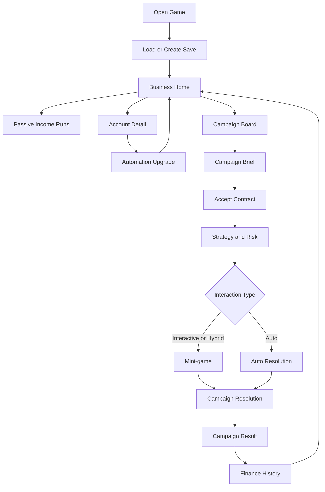

# PRODUCT REQUIREMENTS DOCUMENT (PRD)
# MENJADI BUZZER — v1.0

**Status:** Draft — siap direview sebelum implementasi  
**Versi:** 1.0  
**Tanggal:** 26 November 2026  
**Produk:** Menjadi Buzzer  
**Platform:** Browser Game (Web)  
**Mode:** Single-player  
**Genre:** Semi Idle Management Simulation / Life Simulation / Strategy  
**Dokumen acuan:** GDD v1.0, v1.1, v1.2, dan v1.3 — Idle Revision  
**Referensi UI/visual:** `/ui-reference`  
**Dokumen ide awal:** `brainstorm_menjadibuzzer.md` (immutable; tidak boleh diedit)

---

# 1. TUJUAN DOKUMEN

PRD ini menerjemahkan desain game Menjadi Buzzer ke dalam kebutuhan produk, perilaku sistem, alur pengguna, kriteria penerimaan, dan batas implementasi yang dapat digunakan oleh Product Designer, UI Designer, Developer, serta AI Coding Agent.

PRD ini berfokus pada **MVP / playable prototype** yang membuktikan core gameplay Semi Idle:

1. Akun media sosial menghasilkan pendapatan selama game berjalan.
2. Followers dan performance memengaruhi pendapatan.
3. Pemain dapat meningkatkan pendapatan melalui automation upgrade.
4. Pemain dapat mengambil kontrak kampanye sebagai sumber pendapatan aktif tambahan.
5. Keputusan strategi dan aktivitas interaktif memengaruhi kualitas eksekusi serta peluang hasil.
6. Sistem probabilitas menentukan hasil akhir dan dapat menerapkan konsekuensi kegagalan.
7. Progres tersimpan secara lokal dan tidak terduplikasi setelah refresh.

Dokumen ini bukan spesifikasi seluruh visi jangka panjang game. Sistem multi-account penuh, agensi, staf kompleks, lifestyle, dan Offline Earnings tetap berada di luar MVP.

## 1.1 Cara Membaca Dokumen

- **MUST / Wajib:** harus tersedia agar MVP dapat diterima.
- **SHOULD / Sebaiknya:** penting, tetapi dapat ditunda jika ada kendala waktu yang disetujui.
- **COULD / Opsional:** peningkatan setelah core MVP stabil.
- **Out of Scope:** tidak boleh dikerjakan sebagai bagian MVP kecuali ada perubahan scope yang disetujui.
- Angka ekonomi, probabilitas, harga, dan nilai awal yang disebut sebagai contoh adalah **placeholder konfigurasi**, bukan balancing final.

## 1.2 Hubungan dengan Dokumen Lain

Urutan sumber keputusan:

1. **Brainstorm:** sumber ide/fondasi awal; immutable dan tidak boleh diubah.
2. **GDD Idle Revision v1.0:** visi, pilar desain, core loop, progression, dan batas MVP.
3. **GDD Idle Revision v1.1:** desain sistem akun, passive income, automation, campaign, risk, dan ekonomi.
4. **GDD Idle Revision v1.2:** mekanisme gameplay, formula konseptual, strategi, mini-game, serta resolusi hasil.
5. **GDD Idle Prototype Spec v1.3:** cakupan vertical slice, spesifikasi layar, data, persistence, acceptance criteria.
6. **PRD ini:** kebutuhan produk dan kriteria implementasi untuk MVP.

Jika terdapat detail yang belum diputuskan di GDD, PRD menandainya sebagai asumsi atau keputusan terbuka. Agent tidak boleh mengarang balancing final atau memperluas scope secara sepihak.

---

# 2. PRODUCT OVERVIEW

## 2.1 Product Summary

Menjadi Buzzer adalah game simulasi manajemen bisnis semi-idle. Pemain memulai karier sebagai buzzer individu dengan satu akun media sosial fiktif. Akun menghasilkan pendapatan otomatis ketika game terbuka. Pemain menginvestasikan pendapatan untuk meningkatkan akun dan automation, kemudian mengambil kontrak kampanye untuk memperoleh pembayaran tambahan dengan risiko lebih tinggi.

Pemain harus menyeimbangkan pertumbuhan ekonomi, kualitas akun, reputasi, suspicion, dan potensi kerugian dari kontrak. Dalam visi jangka panjang, pemain berkembang dari individu menjadi jaringan akun dan akhirnya agensi buzzer.

## 2.2 Product Vision

Menyediakan pengalaman simulasi karier buzzer yang mudah dipahami, memiliki progres ekonomi yang terasa, serta memberi keputusan aktif yang menarik melalui kontrak kampanye berisiko.

## 2.3 Product Goals

| ID | Goal | Indikator keberhasilan MVP |
|---|---|---|
| PG-01 | Membuktikan core Semi Idle loop | Pendapatan berjalan saat game terbuka tanpa input berulang |
| PG-02 | Membuat pertumbuhan akun mudah dipahami | Pemain dapat melihat followers, performance, automation, dan dampaknya pada income |
| PG-03 | Memberi keputusan investasi | Upgrade dapat dibeli dan efeknya terlihat |
| PG-04 | Memberi aktivitas aktif yang bermakna | Pemain dapat menerima kontrak, memilih strategi, dan menyelesaikannya |
| PG-05 | Menghadirkan risk-reward | Keputusan mengubah peluang, tetapi outcome tetap memiliki probabilitas |
| PG-06 | Menjaga progres pemain | State tersimpan lokal dan aman dari duplikasi transaksi |
| PG-07 | Menjadi fondasi ekspansi | Data dan konfigurasi dapat dikembangkan tanpa merombak core system |

## 2.4 Non-Goals

MVP tidak bertujuan untuk:

- Menjadi game multiplayer atau game online berbasis akun.
- Mengimplementasikan simulasi media sosial nyata atau terhubung ke platform sosial asli.
- Menyediakan seluruh fitur kehidupan virtual/lifestyle.
- Mengimplementasikan simulasi offline earning.
- Mengimplementasikan sistem agensi, staf, dan banyak akun secara lengkap.
- Memiliki ekonomi final yang sudah seimbang untuk seluruh durasi game.
- Meniru aset, logo, karakter, atau identitas visual game referensi.

---

# 3. TARGET USER & PLAYER EXPERIENCE

## 3.1 Target Player

Pemain yang menyukai game manajemen ringan, idle/incremental, simulasi bisnis, dan permainan dengan pilihan risiko serta reward.

## 3.2 Player Needs

- Memahami dalam beberapa detik apa yang sedang menghasilkan uang.
- Melihat progres meskipun tidak terus-menerus menekan tombol.
- Memiliki pilihan yang jelas untuk menginvestasikan uang.
- Dapat membandingkan kontrak sebelum mengambil risiko.
- Memahami mengapa kampanye berhasil atau gagal.
- Tidak kehilangan progres karena refresh atau berpindah layar.

## 3.3 Experience Principles

1. **Idle first:** pendapatan rutin berjalan otomatis.
2. **Decisions matter:** pemain tetap memiliki keputusan investasi dan kampanye.
3. **Risk is legible:** risiko harus dapat dipahami sebelum pemain mengonfirmasi.
4. **Randomness is fair:** hasil tidak boleh berubah karena refresh atau pengulangan layar.
5. **Progress is visible:** perubahan saldo, income rate, level upgrade, dan kondisi akun harus terlihat.
6. **Low friction:** akses ke Home, Accounts, Upgrade, Campaign, dan Finance harus langsung.
7. **Gradual complexity:** fitur fase jaringan akun dan agensi tidak ditampilkan sebagai kewajiban di awal.

---

# 4. MVP SCOPE

## 4.1 In Scope — MUST

### Player & Account
- Satu player state.
- Satu karakter/avatar sederhana atau placeholder visual.
- Satu akun media sosial fiktif.
- Statistik followers, performance, reputation, suspicion, status, automation level, dan income rate.

### Passive Income
- Pendapatan dihitung berdasarkan elapsed time selama game terbuka.
- Followers dan performance menjadi faktor pendapatan.
- Automation multiplier memengaruhi pendapatan.
- Pendapatan berhenti ketika game ditutup.
- Tidak ada offline earning.
- Pendapatan dan saldo ditampilkan di Home.

### Upgrade & Automation
- Minimal satu jalur automation upgrade dengan beberapa level contoh.
- Harga, level, efek, dan prasyarat disimpan dalam konfigurasi/data.
- Saldo divalidasi sebelum pembelian.
- Efek upgrade terlihat pada income rate.

### Campaign
- Campaign Board berisi kontrak contoh.
- Campaign Brief menampilkan klien, tujuan, reward, bonus, difficulty, risk, dan interaction type.
- Pemain dapat menerima kontrak yang tersedia.
- Pemain dapat memilih strategi/intensitas yang relevan.
- Kontrak dapat menggunakan Auto atau Interactive/Hybrid sesuai konfigurasi.
- Minimal satu mini-game/aktivitas interaktif.
- Sistem menghitung performance score dan success probability.
- Sistem melakukan satu random resolution per campaign.
- Minimal outcome Success dan Failure.

### Risk & Consequences
- Kegagalan dapat memicu denda, reputation decrease, suspicion increase, dan/atau restriction dasar.
- Tidak semua kegagalan harus memicu semua konsekuensi.
- Game Over lengkap tidak termasuk MVP.

### Finance & Persistence
- Saldo pemain.
- Riwayat transaksi income, campaign payment/bonus, upgrade purchase, dan fine.
- Save/load lokal.
- Schema version.
- Proteksi dari double purchase, double reward, dan reroll campaign.

### UI/UX
- Business Home.
- Account Detail.
- Automation Upgrade.
- Campaign Board.
- Campaign Brief.
- Strategy & Risk Selection.
- Interactive Activity.
- Campaign Result.
- Finance & History.
- Desktop dan mobile browser usable.

## 4.2 Should Have

- Status Warning atau Restricted sederhana.
- Indikator perubahan statistik sebelum/sesudah kampanye.
- Ringkasan alasan outcome.
- Konfirmasi sebelum keputusan kampanye yang berisiko tinggi.
- Empty state, error state, dan feedback yang konsisten.
- Reset save untuk keperluan testing, dengan konfirmasi.

## 4.3 Could Have

- Partial Success outcome.
- Satu mini-game kedua jika mini-game pertama stabil dan scope memungkinkan.
- Animasi ringan untuk income, reward, dan penalty.
- Career XP sederhana jika tidak memperluas scope core loop.

## 4.4 Out of Scope

- Offline Earnings.
- Multi-account penuh dan account network management.
- Staff recruitment/management dan agency operations.
- Game Over lengkap.
- Backend, login, cloud save, multiplayer, leaderboard.
- Real social media API atau integrasi akun sosial nyata.
- Stock market, kendaraan, properti, travel, photo mode.
- Lifestyle shop lengkap dan wardrobe system.
- Sistem smartphone sebagai satu-satunya pusat navigasi.
- Campaign editor atau user-generated content.

## 4.5 MVP Completion Boundary

MVP selesai ketika pemain dapat menyelesaikan satu siklus penuh:

`Open Game → View Passive Income → Buy Automation → Review Campaign → Accept → Choose Strategy → Play/Auto Resolve → Success/Failure → Receive Reward/Penalty → View Finance → Return Home`

Siklus tersebut harus tetap benar setelah refresh dan tidak boleh menggandakan transaksi.

---

# 5. INFORMATION ARCHITECTURE & NAVIGATION

## 5.1 Primary Navigation

Navigasi utama harus memberi akses langsung ke:

1. **Home / Business Hub** — ringkasan bisnis dan aktivitas utama.
2. **Accounts** — detail akun dan statistik.
3. **Automation / Upgrade** — peningkatan pendapatan.
4. **Campaigns** — kontrak dan aktivitas kampanye.
5. **Finance** — saldo dan riwayat transaksi.

Menu tambahan dapat disiapkan sebagai locked/coming later hanya jika tidak mengganggu MVP. Jangan membangun halaman palsu yang seolah-olah sudah berfungsi.

## 5.2 Navigation Rules

- Pemain dapat kembali ke Home dari seluruh layar utama.
- Berpindah layar tidak boleh menghapus campaign session yang sedang berlangsung.
- Campaign yang sudah diterima harus dapat dilanjutkan setelah refresh.
- Result yang sudah di-resolve dapat dibuka kembali dari history tanpa menerapkan reward ulang.
- Smartphone boleh menjadi elemen visual/in-world, tetapi bukan lapisan navigasi wajib.

## 5.3 Main User Flow



---

# 6. FUNCTIONAL REQUIREMENTS

## 6.1 Player & Save Initialization

| ID | Priority | Requirement | Acceptance Criteria |
|---|---|---|---|
| FR-001 | MUST | Sistem harus membuat player state baru saat belum ada save. | Game dapat dibuka pertama kali tanpa error dan menampilkan Home dengan satu akun awal. |
| FR-002 | MUST | Sistem harus memuat save yang valid saat game dibuka ulang. | Saldo, akun, upgrade, campaign history, dan transaksi kembali sesuai save terakhir. |
| FR-003 | MUST | Sistem harus menyediakan starting state melalui konfigurasi. | Nilai awal tidak tersebar/hardcode di banyak komponen. |
| FR-004 | SHOULD | Sistem menyediakan reset save untuk testing. | Reset meminta konfirmasi dan mengembalikan state ke starting state. |

Starting state contoh untuk prototype:

| Parameter | Nilai contoh |
|---|---:|
| Career Level | 1 |
| Money | 500 |
| Reputation | 0 |
| Career XP | 0 |
| Account Count | 1 |
| Followers | 1.000 |
| Performance | 50 |
| Suspicion | 10 |
| Automation Level | 0 |
| Account Status | Normal |
| Completed Campaigns | 0 |

Semua angka pada tabel adalah placeholder yang harus dapat diubah dari konfigurasi.

## 6.2 Business Home

| ID | Priority | Requirement | Acceptance Criteria |
|---|---|---|---|
| FR-010 | MUST | Home menampilkan saldo pemain. | Saldo terlihat dan berubah setelah income, purchase, payment, atau fine. |
| FR-011 | MUST | Home menampilkan passive income rate. | Nilai rate diperbarui setelah perubahan followers, performance, automation, atau status. |
| FR-012 | MUST | Home menampilkan ringkasan akun. | Followers, performance, suspicion, dan status akun dapat dibaca. |
| FR-013 | MUST | Home menyediakan shortcut ke Campaign Board dan Upgrade. | Pemain dapat membuka kedua fitur tanpa menu berlapis yang tidak perlu. |
| FR-014 | SHOULD | Home menampilkan notifikasi perubahan penting. | Reward, fine, upgrade, atau perubahan status terlihat tanpa pemain harus menelusuri data mentah. |

## 6.3 Account Management

| ID | Priority | Requirement | Acceptance Criteria |
|---|---|---|---|
| FR-020 | MUST | Sistem menyediakan satu akun awal. | Akun memiliki ID unik dan statistik yang diperlukan. |
| FR-021 | MUST | Account Detail menampilkan followers dan performance secara terpisah. | UI menjelaskan bahwa kedua statistik sama-sama berkontribusi pada income. |
| FR-022 | MUST | Account Detail menampilkan reputation, suspicion, status, automation level, dan income rate. | Nilai mengikuti state terbaru. |
| FR-023 | SHOULD | Perubahan statistik akun ditampilkan setelah campaign. | Result screen menunjukkan nilai perubahan, bukan hanya nilai akhir. |
| FR-024 | MUST | Status akun dapat memodifikasi income atau ketersediaan aktivitas sesuai konfigurasi. | Modifier diterapkan oleh game logic, bukan hanya label UI. |

## 6.4 Passive Income Engine

| ID | Priority | Requirement | Acceptance Criteria |
|---|---|---|---|
| FR-030 | MUST | Income dihitung menggunakan elapsed time, bukan frame count. | Hasil konsisten pada perangkat dengan frame rate berbeda. |
| FR-031 | MUST | Income dipengaruhi followers dan performance. | Mengubah salah satu faktor mengubah income rate sesuai konfigurasi. |
| FR-032 | MUST | Income dipengaruhi automation multiplier. | Upgrade automation meningkatkan income rate. |
| FR-033 | MUST | Income hanya bertambah selama game terbuka. | Setelah game ditutup dan dibuka kembali, tidak ada income untuk periode game tertutup. |
| FR-034 | MUST | Game tetap menghitung delta waktu aktual ketika browser men-throttle update atau tab tidak aktif selama halaman masih terbuka. | Saat update berikutnya, income dihitung berdasarkan elapsed time aktual yang valid. |
| FR-035 | MUST | Income calculation dipusatkan pada satu service/module. | UI tidak memiliki formula pendapatan duplikat. |
| FR-036 | MUST | Perpindahan layar tidak boleh mereset atau menggandakan income. | Total income tetap konsisten sebelum dan sesudah navigasi. |
| FR-037 | SHOULD | Pemain dapat melihat akumulasi income terkini secara real-time atau pada interval update yang wajar. | Tampilan tidak harus berubah setiap frame, tetapi terasa responsif. |

### 6.4.1 Income Formula Contract

Gunakan kerangka formula dari GDD:

```text
incomePerSecond = baseRate
                * followersFactor
                * performanceFactor
                * automationMultiplier
                * statusModifier

incomeEarned = incomePerSecond * elapsedSeconds
```

Ketentuan:
- Formula dan faktor harus terpusat di konfigurasi/game logic.
- Nilai faktor, kurva, cap, dan interval update adalah balancing data.
- Hindari angka final yang tidak disetujui.
- Gunakan tipe angka yang cukup presisi untuk akumulasi; format pembulatan hanya pada tampilan.
- Jangan menghitung income dua kali ketika menyimpan state.

### 6.4.2 Income Crediting UX — PRD Baseline

GDD mencatat auto-credit versus manual claim sebagai keputusan UX yang belum final. Untuk baseline implementasi PRD ini, gunakan **auto-credit**: income langsung menambah saldo ketika waktu berjalan, dan Home menampilkan income rate serta pertambahan saldo.

Alasan: passive income harus terasa otomatis dan tidak menambah tugas claim berulang. Implementasi income engine tetap harus memisahkan kalkulasi accrual dari mekanisme crediting agar mode manual claim dapat ditambahkan kemudian tanpa mengubah formula inti.

Jika keputusan auto-credit ini belum disetujui pada review PRD, agent harus mempertahankan pemisahan tersebut dan tidak mengunci UX claim ke dalam income engine.

### 6.4.3 Active-Time Rules

- Game dianggap aktif selama aplikasi/game page masih berjalan.
- Tab yang sedang tidak terlihat tetap dihitung selama halaman masih hidup; browser throttling ditangani dengan elapsed time.
- Ketika halaman ditutup atau sesi berakhir, income berhenti.
- Saat load ulang, jangan menghitung selisih waktu sejak save terakhir sebagai offline income.
- Timestamp hanya digunakan untuk menghitung waktu dalam sesi aktif dan menjaga konsistensi save.

## 6.5 Automation & Upgrade

| ID | Priority | Requirement | Acceptance Criteria |
|---|---|---|---|
| FR-040 | MUST | Sistem menyediakan automation upgrade dengan beberapa level contoh. | Pemain dapat melihat level dan level berikutnya. |
| FR-041 | MUST | Upgrade menampilkan nama, deskripsi, harga, efek, dan level. | Informasi tersedia sebelum pemain membeli. |
| FR-042 | MUST | Sistem memvalidasi saldo sebelum purchase. | Purchase disabled/ditolak jika saldo kurang. |
| FR-043 | MUST | Purchase mengurangi saldo tepat satu kali. | Double click atau refresh tidak menggandakan pengurangan/pemberian upgrade. |
| FR-044 | MUST | Upgrade meningkatkan automation level/multiplier. | Income rate berubah setelah pembelian. |
| FR-045 | MUST | Upgrade tersimpan setelah refresh. | Level dan saldo sesuai dengan kondisi sebelum refresh. |
| FR-046 | SHOULD | UI menampilkan perubahan income rate sebelum dan sesudah upgrade. | Pemain dapat memahami manfaat upgrade. |
| FR-047 | MUST | Harga dan efek upgrade berasal dari konfigurasi data. | Balancing dapat diubah tanpa mengedit komponen UI. |

Upgrade data minimal:

```json
{
  "id": "automation-basic",
  "name": "Workflow Automation",
  "description": "Meningkatkan efisiensi operasional akun.",
  "levels": [
    { "level": 1, "cost": 100, "incomeMultiplier": 1.1 },
    { "level": 2, "cost": 250, "incomeMultiplier": 1.25 }
  ]
}
```

Contoh di atas hanya bentuk data dan angka ilustratif, bukan balancing final.

## 6.6 Campaign Board & Contract

| ID | Priority | Requirement | Acceptance Criteria |
|---|---|---|---|
| FR-050 | MUST | Campaign Board menampilkan kontrak yang tersedia. | Setiap card menampilkan nama, client, difficulty, payment, bonus, risk, dan interaction type. |
| FR-051 | MUST | Pemain dapat membuka Campaign Brief. | Brief menampilkan seluruh informasi yang dibutuhkan untuk mengambil keputusan. |
| FR-052 | MUST | Pemain dapat menerima kontrak yang eligible. | Accept membuat campaign session dan mengubah status kontrak. |
| FR-053 | MUST | Sistem mencegah kontrak diterima lebih dari sekali jika statusnya tidak available. | Kontrak yang sudah diterima tidak dapat diterima ulang. |
| FR-054 | MUST | Contract data disimpan terpisah dari UI. | Campaign dapat ditambah/diubah melalui data/config. |
| FR-055 | MUST | Kontrak memiliki interaction type Auto, Interactive, atau Hybrid. | Jenis interaksi menentukan alur yang ditampilkan. |
| FR-056 | SHOULD | Campaign Board memberi filter/sort sederhana berdasarkan risk atau reward. | Pemain dapat membandingkan kontrak dengan mudah; dapat ditunda jika daftar kontrak sangat kecil. |

Campaign data minimal:

- `id`
- `client`
- `campaignName`
- `objective`
- `targetAudience`
- `eligibleAccount`
- `difficulty`
- `basePayment`
- `bonusPayment`
- `baseRisk`
- `strategyTags`
- `interactionType`
- `status`
- `consequenceProfile` atau referensi konfigurasi konsekuensi

Minimal seed content: beberapa kontrak contoh yang mewakili variasi risk/reward dan interaction type. Jumlah serta angka detail dapat disesuaikan untuk balancing, tetapi campaign board tidak boleh hanya menampilkan satu opsi yang tidak memungkinkan perbandingan.

## 6.7 Strategy & Risk Selection

| ID | Priority | Requirement | Acceptance Criteria |
|---|---|---|---|
| FR-060 | MUST | Pemain memilih strategi sebelum campaign resolve. | Pilihan tersimpan di campaign session. |
| FR-061 | MUST | Pilihan strategi memengaruhi performance modifier dan/atau success probability. | Perubahan strategi menghasilkan perubahan input kalkulasi. |
| FR-062 | MUST | Pemain dapat memilih activity intensity/risk posture jika relevan. | Pilihan Low/Normal/High atau Conservative/Balanced/Aggressive diterapkan sesuai kontrak. |
| FR-063 | MUST | UI menampilkan estimated reward/bonus dan risk indicator. | Pemain mendapat informasi trade-off sebelum konfirmasi. |
| FR-064 | MUST | Hanya parameter relevan yang ditampilkan untuk tiap kontrak. | UI tidak memaksa semua kontrak menggunakan seluruh parameter strategi. |
| FR-065 | SHOULD | UI menampilkan account condition warning. | Peringatan muncul ketika suspicion/status/reputation meningkatkan risiko. |

Pilihan strategi konseptual dari GDD:

- Content Approach: Informative, Emotional, Humorous, Provocative, atau variasi yang relevan.
- Communication Style: Casual, Persuasive, Aggressive, Satirical, Formal.
- Publication Timing: Quiet, Normal, Peak.
- Activity Intensity: Low, Normal, High.
- Risk Posture: Conservative, Balanced, Aggressive.

Tidak semua opsi harus dibuat untuk MVP. Set pilihan yang diimplementasikan harus sederhana, relevan dengan campaign seed, dan disimpan dalam konfigurasi.

## 6.8 Interactive Activity / Mini-game

| ID | Priority | Requirement | Acceptance Criteria |
|---|---|---|---|
| FR-070 | MUST | MVP menyediakan minimal satu mini-game. | Kontrak Interactive/Hybrid yang sesuai dapat membuka mini-game. |
| FR-071 | MUST | Mini-game menghasilkan execution/performance score. | Skor tersimpan pada campaign session. |
| FR-072 | MUST | Skor mini-game menjadi salah satu input campaign resolution. | Skor dapat mengubah modifier, tetapi tidak menjamin success. |
| FR-073 | MUST | Kontrak Auto tidak memaksa pemain bermain mini-game. | Auto contract dapat dilanjutkan ke resolution tanpa mini-game. |
| FR-074 | MUST | Hasil mini-game tidak dapat diulang untuk mengejar skor lebih baik kecuali aturan kontrak mengizinkan. | Refresh/back tidak mereset attempt atau mengganti skor. |
| FR-075 | SHOULD | Mini-game mendukung mouse dan touch. | Kontrol dapat digunakan di desktop dan mobile browser. |

Mini-game kandidat:

1. Caption Challenge — memilih caption yang paling sesuai dengan brief dan audiens.
2. Engagement Challenge — aktivitas timing/interaksi untuk meningkatkan execution score.

MVP harus mengimplementasikan **satu mini-game terlebih dahulu**. Jenis final dipilih dari kandidat di atas pada tahap desain UI/UX. Jangan membuat banyak mini-game sebelum core campaign loop stabil.

## 6.9 Campaign Resolution & Outcome

| ID | Priority | Requirement | Acceptance Criteria |
|---|---|---|---|
| FR-080 | MUST | Sistem menghitung performance score terpisah dari success probability. | Nilai performa tinggi tidak otomatis berarti success. |
| FR-081 | MUST | Success probability dipengaruhi data campaign, kondisi akun, strategi, intensitas, dan execution score. | Faktor yang relevan masuk ke kalkulasi. |
| FR-082 | MUST | Sistem melakukan satu random roll ketika campaign di-resolve. | Hasil tidak berubah ketika layar dibuka ulang atau page di-refresh. |
| FR-083 | MUST | MVP mendukung outcome Success dan Failure. | Kedua outcome dapat diuji. |
| FR-084 | COULD | Partial Success dapat ditambahkan. | Jika diterapkan, definisi reward dan consequence harus jelas. |
| FR-085 | MUST | Resolution memvalidasi campaign state sebelum diproses. | Campaign hanya dapat di-resolve jika state valid dan belum pernah resolved. |
| FR-086 | MUST | Result snapshot disimpan. | Outcome, random roll, probability, score, reward, dan penalty dapat ditampilkan kembali. |
| FR-087 | MUST | Reward/penalty diterapkan tepat satu kali. | Refresh atau navigasi tidak mengulang transaksi. |

### 6.9.1 Resolution Order

Urutan proses wajib:

1. Validasi campaign session dan status akun.
2. Ambil snapshot statistik akun yang digunakan.
3. Hitung strategy/performance modifiers.
4. Hitung success probability dan risk exposure.
5. Jalankan satu random roll.
6. Tentukan outcome.
7. Hitung base payment dan bonus.
8. Hitung perubahan followers/performance/reputation/suspicion.
9. Tentukan penalty/restriction sesuai severity.
10. Simpan campaign result dan transaction record secara konsisten.
11. Tampilkan Campaign Result.

### 6.9.2 Probability Contract

Kerangka konseptual:

```text
successProbability = clamp(
  baseProbability
  + playerModifiers
  + accountModifiers
  + executionModifiers,
  minProbability,
  maxProbability
)
```

Ketentuan:
- Semua bobot dan batas probability adalah konfigurasi.
- Formula harus berada di game logic, bukan UI.
- Random roll dilakukan satu kali per campaign session.
- Random roll dan probability yang digunakan disimpan dalam result snapshot.
- Strategi pemain memengaruhi peluang, bukan menjamin outcome.
- Hindari menampilkan persentase presisi kepada pemain kecuali diputuskan dalam balancing/UX; risk indicator tetap wajib.

## 6.10 Reward, Penalty & Account Consequences

| ID | Priority | Requirement | Acceptance Criteria |
|---|---|---|---|
| FR-090 | MUST | Success memberikan base payment sesuai campaign data. | Saldo bertambah sesuai hasil resolusi. |
| FR-091 | MUST | Bonus diberikan sesuai aturan target/performance campaign. | Bonus dicatat terpisah dari base payment jika keduanya berlaku. |
| FR-092 | MUST | Failure dapat mengurangi atau meniadakan pembayaran. | Hasil mengikuti consequence/reward profile. |
| FR-093 | MUST | Failure dapat menerapkan fine dan reputation decrease. | Minimal satu skenario failure menghasilkan denda dan reputasi turun. |
| FR-094 | MUST | Suspicion diperbarui berdasarkan hasil dan severity. | Nilai suspicion berubah sesuai konfigurasi. |
| FR-095 | SHOULD | Restriction dasar dapat diterapkan. | Status akun berubah dan modifier terkait ikut diterapkan. |
| FR-096 | MUST | Tidak semua failure harus menerapkan semua konsekuensi. | Konsekuensi dipilih berdasarkan severity/profile. |
| FR-097 | SHOULD | Result menjelaskan konsekuensi yang diterapkan. | Pemain dapat mengetahui denda dan perubahan statistik. |

Possible account status:

- Normal
- Warning
- Restricted
- Temporarily Suspended

Status dan konsekuensi harus proporsional. Restriction/suspension dapat ditunda jika belum dibutuhkan untuk vertical slice, tetapi struktur status sebaiknya tidak menghalangi penambahannya.

## 6.11 Finance & Transaction History

| ID | Priority | Requirement | Acceptance Criteria |
|---|---|---|---|
| FR-100 | MUST | Finance menampilkan saldo saat ini. | Nilai sama dengan player state. |
| FR-101 | MUST | Sistem mencatat passive income. | Income dapat dikenali di history. |
| FR-102 | MUST | Sistem mencatat campaign payment dan bonus. | Payment/bonus tercatat dengan referensi campaign. |
| FR-103 | MUST | Sistem mencatat upgrade purchase. | Transaksi menunjukkan biaya dan upgrade terkait. |
| FR-104 | MUST | Sistem mencatat fine/penalty. | Denda tercatat sebagai pengeluaran. |
| FR-105 | MUST | Setiap transaksi memiliki ID unik dan waktu. | Tidak ada transaksi duplikat untuk satu event. |
| FR-106 | SHOULD | History dapat dibedakan berdasarkan tipe transaksi. | Pemain dapat memahami sumber income dan expense. |

Transaction types minimal:

- `passive_income`
- `campaign_payment`
- `campaign_bonus`
- `upgrade_purchase`
- `campaign_fine`

## 6.12 Campaign History & Resume

| ID | Priority | Requirement | Acceptance Criteria |
|---|---|---|---|
| FR-110 | MUST | Sistem menyimpan campaign history. | Campaign selesai dapat dilihat kembali. |
| FR-111 | MUST | Campaign yang accepted/in progress tersimpan. | Refresh tidak menghilangkan session. |
| FR-112 | MUST | Campaign result dapat dibuka kembali. | Membuka ulang result tidak mengubah saldo/statistik. |
| FR-113 | MUST | State transition divalidasi. | Tidak ada transisi ilegal atau resolve ganda. |

Campaign lifecycle:

`Available → Accepted → In Progress → Resolved → Completed / Failed`

Status `Resolved` adalah status pemrosesan hasil; `Completed` atau `Failed` adalah status akhir yang ditampilkan kepada pemain. Implementasi boleh menyederhanakan enum internal selama transisi dan proteksi idempotency tetap terjaga.

---

# 7. SCREEN-LEVEL REQUIREMENTS

## 7.1 Screen 01 — Business Home

**Tujuan:** pusat ringkasan dan akses tindakan utama.

Komponen wajib:
- Area karakter/avatar atau ilustrasi representatif.
- Saldo pemain.
- Passive income rate.
- Feedback pertambahan saldo/income.
- Ringkasan satu akun: nama, followers, performance, suspicion, status.
- Automation level atau shortcut upgrade.
- Shortcut Campaign Board.
- Shortcut Finance/History.

Perilaku:
- Data selalu mencerminkan state terkini.
- Income terus dihitung ketika pemain berada di layar lain.
- Tombol utama memiliki feedback loading/disabled ketika aksi sedang diproses.

## 7.2 Screen 02 — Account Detail

Komponen wajib:
- Nama akun dan platform fiktif.
- Followers.
- Performance.
- Reputation.
- Suspicion.
- Account status.
- Passive income rate.
- Automation level.
- Informasi singkat pengaruh followers/performance pada income.
- Shortcut upgrade.

## 7.3 Screen 03 — Automation Upgrade

Setiap upgrade card menampilkan:
- Nama dan deskripsi.
- Level saat ini dan level berikutnya.
- Harga.
- Efek income/multiplier.
- Prasyarat jika ada.
- Tombol purchase.

Perilaku:
- Purchase disabled jika saldo tidak cukup atau upgrade max level.
- Konfirmasi tidak wajib untuk pembelian normal kecuali biaya sangat besar menurut balancing.
- Setelah purchase, tampilkan saldo dan income rate terbaru.

## 7.4 Screen 04 — Campaign Board

Setiap campaign card menampilkan:
- Campaign name.
- Client.
- Category/objective ringkas.
- Difficulty.
- Base payment.
- Potential bonus.
- Risk indicator.
- Interaction type.
- Status/eligibility.

Perilaku:
- Kontrak yang tidak eligible harus diberi alasan.
- Kontrak yang sudah accepted/completed/failed tidak dapat diterima ulang.
- Daftar kontrak harus dapat diisi dari seed/config data.

## 7.5 Screen 05 — Campaign Brief

Informasi wajib:
- Campaign ID (boleh tidak ditampilkan kepada pemain).
- Client.
- Objective.
- Target audience.
- Eligible account.
- Difficulty.
- Base payment.
- Potential bonus.
- Base risk/risk indicator.
- Interaction type.
- Ringkasan kemungkinan konsekuensi.

Aksi:
- Accept Contract.
- Back to Board.

Accept tidak langsung menentukan outcome. Sistem membuat session terlebih dahulu.

## 7.6 Screen 06 — Strategy & Risk Selection

Komponen:
- Pilihan strategi yang relevan.
- Activity intensity/risk posture.
- Estimated reward/bonus.
- Risk indicator.
- Account condition warning.
- Confirm/Continue.

Perilaku:
- Pilihan default tidak boleh diam-diam mengarahkan pemain ke strategi paling berisiko.
- Pemain dapat kembali sebelum campaign resolve.
- Setelah strategi dikonfirmasi dan activity dimulai, pilihan disimpan sebagai bagian session.

## 7.7 Screen 07 — Interactive Activity

Komponen:
- Campaign objective/brief ringkas.
- Instruksi singkat.
- Input/interaction yang diperlukan.
- Timer atau batas percobaan jika memang dibutuhkan mini-game.
- Feedback hasil.

Perilaku:
- Hasil mini-game disimpan sebelum berpindah ke resolution.
- Refresh tidak mengizinkan attempt baru secara gratis.
- Kontrol mendukung pointer/touch.
- Mini-game harus singkat dan tidak menjadi aktivitas berulang untuk memperoleh passive income.

## 7.8 Screen 08 — Campaign Result

Komponen:
- Outcome Success/Failure (Partial Success jika diaktifkan).
- Performance score.
- Payment dan bonus.
- Followers/performance change jika ada.
- Reputation change.
- Suspicion change.
- Fine/penalty jika ada.
- Account status/restriction jika berubah.
- Ringkasan alasan hasil.
- Tombol kembali ke Home/Board.

Perilaku:
- Semua reward dan consequence sudah diterapkan sebelum result ditampilkan.
- Tidak ada tombol claim yang dapat menerapkan reward untuk kedua kalinya.

## 7.9 Screen 09 — Finance & History

Komponen:
- Saldo saat ini.
- Daftar transaksi.
- Tipe transaksi.
- Nominal masuk/keluar.
- Waktu.
- Referensi campaign/upgrade jika relevan.

Perilaku:
- Urutkan transaksi terbaru lebih dahulu.
- Tampilkan empty state jika belum ada transaksi.
- Riwayat tidak dapat mengubah state ekonomi.

---

# 8. DATA & STATE REQUIREMENTS

## 8.1 Conceptual Data Structure

Struktur berikut adalah acuan konseptual. Nama field dapat disesuaikan dengan codebase, tetapi pemisahan domain harus dipertahankan.

```json
{
  "schemaVersion": 1,
  "player": {
    "id": "player-001",
    "money": 500,
    "reputation": 0,
    "careerLevel": 1,
    "careerXP": 0
  },
  "accounts": [
    {
      "id": "account-001",
      "name": "@KilatDaily",
      "platform": "Chirper",
      "followers": 1000,
      "performance": 50,
      "reputation": 0,
      "suspicion": 10,
      "status": "normal",
      "automationLevel": 0
    }
  ],
  "automationUpgrades": [],
  "campaignSessions": [],
  "campaignHistory": [],
  "transactions": [],
  "activeSession": {
    "startedAt": null,
    "lastAccrualAt": null
  }
}
```

Nilai contoh tidak mengikat. Tambahkan field yang diperlukan selama konsisten dengan domain dan tidak menggandakan sumber kebenaran.

## 8.2 Domain Separation

Minimal pisahkan tanggung jawab berikut:

- Player/economy state.
- Account state.
- Income calculation.
- Upgrade definitions dan purchase processing.
- Campaign definitions.
- Campaign session/state transitions.
- Strategy/performance calculation.
- Random outcome resolution.
- Penalty/reward processing.
- Transaction history.
- Persistence/save migration.

Komponen UI tidak boleh menjadi tempat utama formula ekonomi, probability, atau mutation data.

## 8.3 Data Integrity & Idempotency

MUST:
- Setiap entity memiliki ID stabil.
- Setiap transaksi memiliki ID unik.
- Setiap campaign result memiliki session/campaign reference.
- Campaign yang sudah resolved tidak dapat di-resolve lagi.
- Random roll disimpan bersama result.
- Reward, bonus, fine, dan perubahan statistik diterapkan satu kali.
- Purchase upgrade divalidasi dan diterapkan satu kali.
- Passive income tidak dihitung ulang atas interval waktu yang sama.
- Navigasi tidak menginisialisasi ulang game state.
- Save memiliki schema version.

## 8.4 Persistence

Untuk MVP gunakan local persistence browser (misalnya localStorage atau mekanisme setara yang sesuai codebase).

Simpan minimal:
- Player state.
- Account state.
- Automation upgrades.
- Passive income state/timestamp sesi.
- Campaign sessions dan history.
- Campaign result snapshot.
- Transaction history.
- Schema version.

Simpan setelah tindakan penting:
- Income accrual/credit.
- Upgrade purchase.
- Contract accept.
- Strategy confirmation.
- Mini-game completion.
- Campaign resolution.
- Penalty/reward application.

Jika save corrupt atau tidak dapat dibaca:
- Jangan crash tanpa penjelasan.
- Berikan recovery path yang jelas.
- Jangan diam-diam menimpa save valid tanpa konfirmasi.

---

# 9. CONFIGURATION & BALANCING REQUIREMENTS

Semua nilai balancing harus berada pada konfigurasi terpusat atau data seed, bukan tersebar di komponen UI.

Konfigurasi minimal:

- Starting player/account values.
- Base income rate.
- Followers factor/curve.
- Performance factor/curve.
- Automation multiplier per level.
- Upgrade cost per level.
- Campaign payment/bonus.
- Campaign base risk/base probability.
- Strategy modifiers.
- Mini-game score modifiers.
- Probability min/max clamp.
- Fine/reputation/suspicion consequences.
- Account status modifiers.

## 9.1 Balancing Principles

- Passive income harus terasa bertambah, tetapi tidak merusak ekonomi dengan pertumbuhan tak terkendali.
- Upgrade harus memiliki manfaat yang dapat dipahami.
- Harga upgrade harus menjadi keputusan investasi, bukan angka acak.
- Campaign harus menjadi sumber income tambahan, bukan kewajiban untuk menjaga bisnis tetap hidup.
- Reward tinggi harus memiliki risiko yang sepadan.
- Strategi agresif dapat meningkatkan potensi reward/bonus sekaligus risiko.
- Mini-game memengaruhi kualitas eksekusi, tetapi tidak menjamin success.
- Failure harus berdampak namun masih memungkinkan recovery.

## 9.2 Balancing Values Not Finalized

Jangan mengunci angka berikut sebagai nilai final tanpa playtesting/approval:

- Income per second dan kurva follower/performance.
- Cost dan multiplier upgrade.
- Campaign payment dan bonus.
- Base risk/probability.
- Bobot strategi dan mini-game.
- Batas probability.
- Besaran fine dan perubahan reputation/suspicion.
- Threshold Warning/Restricted/Suspended.

---

# 10. UI, VISUAL & ART DIRECTION REQUIREMENTS

## 10.1 Mandatory UI Reference Folder

Folder referensi utama proyek harus tersedia di root project dengan path persis:

`/ui-reference`

Folder tersebut berisi screenshot referensi UI, visual, art style, layout, komponen, dan pola interaksi dari game referensi yang telah dikumpulkan.

**Instruksi wajib untuk seluruh agent/designer:**

1. Pelajari seluruh screenshot di `/ui-reference` sebelum membuat atau mengubah UI.
2. Identifikasi pola layout, hierarki informasi, bentuk panel/card, navigasi, tombol, ikon, spacing, dan feedback.
3. Gunakan referensi sebagai acuan bahasa visual dan pola UX.
4. Jangan menyalin aset, logo, karakter, nama, atau identitas visual milik game referensi.
5. Bangun identitas visual orisinal Menjadi Buzzer dengan tetap mempertahankan pola UI yang relevan.
6. Jangan mengabaikan screenshot yang sudah disediakan dan menggantinya dengan desain generik tanpa alasan.

Jika folder `/ui-reference` tidak ditemukan atau tidak dapat dibaca, agent harus melaporkan hal tersebut dan meminta sumber referensi sebelum menyelesaikan UI final. Jangan berpura-pura telah mempelajari referensi.

## 10.2 UI Principles

- Hierarki saldo, income, akun, dan aksi utama harus jelas.
- Informasi penting dapat dipindai dengan cepat.
- Card/panel digunakan untuk mengelompokkan data terkait.
- Risk indicator harus terlihat sebelum kontrak diterima.
- Success dan Failure harus memiliki feedback visual yang berbeda dan mudah dikenali.
- Informasi detail tidak boleh membuat Home terlalu padat.
- UI harus konsisten antar layar.
- Gunakan aset orisinal atau placeholder sementara yang legal.

## 10.3 Responsive Requirements

- Desktop browser menjadi target layout utama.
- Mobile browser tetap dapat digunakan tanpa horizontal overflow yang tidak disengaja.
- Layout menyesuaikan lebar layar; komponen penting tidak terpotong.
- Tombol dan kontrol mini-game memiliki ukuran target sentuh yang memadai.
- Finance/history dapat discroll dengan nyaman pada layar kecil.

## 10.4 UI States

Setiap layar yang relevan harus memiliki:
- Default state.
- Loading/processing state jika ada proses asynchronous.
- Disabled state untuk aksi yang tidak valid.
- Empty state.
- Error state dengan pesan yang dapat dipahami.
- Success/failure feedback untuk mutation.

---

# 11. NON-FUNCTIONAL REQUIREMENTS

## 11.1 Performance

- Game harus tetap responsif pada browser desktop dan mobile modern.
- Income update tidak boleh memicu render berat setiap frame.
- Perhitungan ekonomi harus efisien dan terpusat.
- Hindari animasi berlebihan yang menghambat interaksi.

## 11.2 Reliability

- Refresh tidak boleh menghapus progres yang sudah tersimpan.
- Navigasi tidak boleh mereset state.
- Error pada satu campaign tidak boleh merusak save keseluruhan.
- Sistem harus menangani saldo tidak cukup, campaign invalid, dan data konfigurasi tidak lengkap secara aman.

## 11.3 Compatibility

- Mendukung browser modern berbasis Chromium, Firefox, dan Safari sejauh fitur web standar memungkinkan.
- Mendukung input mouse, keyboard untuk navigasi dasar, dan touch.
- Tidak memerlukan instalasi aplikasi native.

## 11.4 Accessibility & Usability

- Teks penting memiliki kontras yang cukup.
- Tombol memiliki label yang jelas.
- Status tidak hanya dibedakan dengan warna; sertakan label/ikon/teks.
- Kontrol utama dapat diakses dengan keyboard bila memungkinkan.
- Jangan menggunakan animasi berkedip atau gerakan yang mengganggu.

## 11.5 Privacy & Security

- MVP tidak mengumpulkan data pribadi dan tidak memerlukan akun pengguna.
- Tidak meminta kredensial media sosial asli.
- Tidak mengirim save game ke server.
- Validasi ekonomi dan campaign dilakukan pada game logic, bukan hanya dengan menyembunyikan tombol di UI.
- Jangan menaruh secret/API key di client.

---

# 12. ERROR HANDLING & EDGE CASES

| ID | Kondisi | Perilaku yang diharapkan |
|---|---|---|
| EC-01 | Saldo kurang saat purchase | Purchase ditolak, saldo tidak berubah, tampilkan alasan. |
| EC-02 | Tombol purchase diklik cepat berulang | Hanya satu purchase diproses. |
| EC-03 | Campaign sudah accepted | Accept berikutnya ditolak. |
| EC-04 | Campaign sudah resolved | Resolve berikutnya ditolak dan result lama ditampilkan. |
| EC-05 | Refresh saat campaign berlangsung | Session dipulihkan dari save dan pemain dapat melanjutkan. |
| EC-06 | Refresh setelah mini-game selesai | Skor tersimpan; attempt tidak diulang gratis. |
| EC-07 | Refresh pada result screen | Result yang sama ditampilkan tanpa reward ulang. |
| EC-08 | Browser tab inactive/throttled | Elapsed time dihitung saat update berikutnya selama halaman masih berjalan. |
| EC-09 | Game ditutup lalu dibuka lagi | Tidak ada offline income yang ditambahkan. |
| EC-10 | Save tidak valid/corrupt | Tampilkan error/recovery path; jangan crash diam-diam. |
| EC-11 | Campaign config tidak lengkap | Campaign tidak dapat dimainkan; tampilkan fallback/log yang jelas untuk developer. |
| EC-12 | Fine lebih besar dari saldo | Terapkan aturan saldo minimum/utang sesuai konfigurasi; jangan membuat saldo NaN/undefined. Default MVP: saldo tidak boleh menjadi NaN atau negatif tanpa aturan eksplisit. |
| EC-13 | Income sangat kecil | Akumulasi presisi dipertahankan; tampilan dapat membulatkan sesuai format mata uang. |
| EC-14 | Perpindahan layar ketika income berjalan | Income tetap konsisten dan tidak reset. |
| EC-15 | Pengguna menekan Back saat mini-game/session aktif | Session tetap tersimpan; tidak mengulang atau menghapus keputusan yang sudah dikonfirmasi. |

---

# 13. ACCEPTANCE CRITERIA — END-TO-END

MVP dinyatakan diterima apabila seluruh kriteria MUST berikut lulus.

## 13.1 First Launch & Home

- [ ] Game dapat dibuka tanpa save sebelumnya.
- [ ] Satu player dan satu akun awal dibuat.
- [ ] Home menampilkan saldo, income rate, dan ringkasan akun.
- [ ] Navigasi utama dapat digunakan.

## 13.2 Passive Income

- [ ] Income bertambah ketika game terbuka.
- [ ] Income dihitung dari elapsed time, bukan frame count.
- [ ] Followers dan performance memengaruhi income.
- [ ] Automation multiplier memengaruhi income.
- [ ] Income tidak bertambah selama game tertutup.
- [ ] Tab inactive/browser throttling tidak membuat perhitungan drift yang tidak wajar.
- [ ] Pindah layar tidak menggandakan atau menghilangkan income.

## 13.3 Upgrade

- [ ] Pemain dapat melihat detail upgrade.
- [ ] Purchase tidak dapat dilakukan jika saldo kurang.
- [ ] Purchase mengurangi saldo satu kali.
- [ ] Upgrade level dan income rate diperbarui.
- [ ] Upgrade tetap ada setelah refresh.

## 13.4 Campaign

- [ ] Campaign Board menampilkan kontrak contoh.
- [ ] Brief menampilkan reward, bonus, difficulty, risk, dan interaction type.
- [ ] Pemain dapat menerima kontrak eligible.
- [ ] Pemain dapat memilih strategi/intensitas.
- [ ] Auto contract dapat di-resolve tanpa mini-game.
- [ ] Interactive/Hybrid contract dapat menjalankan satu mini-game.
- [ ] Mini-game menghasilkan skor yang tersimpan.
- [ ] Strategi dan skor memengaruhi perhitungan.
- [ ] Outcome diputuskan melalui satu random roll.
- [ ] Minimal Success dan Failure dapat terjadi melalui test configuration.

## 13.5 Result & Finance

- [ ] Success menerapkan payment/bonus sesuai konfigurasi.
- [ ] Failure dapat menerapkan fine dan reputation decrease.
- [ ] Suspicion diperbarui sesuai aturan.
- [ ] Restriction dasar berfungsi jika diaktifkan.
- [ ] Result menjelaskan perubahan utama.
- [ ] Setiap transaksi tercatat satu kali.
- [ ] Result dapat dibuka kembali tanpa menerapkan ulang reward/penalty.

## 13.6 Persistence & Reliability

- [ ] Save/load lokal berfungsi.
- [ ] Refresh tidak menghapus progres.
- [ ] Campaign in progress dapat dilanjutkan.
- [ ] Random roll tidak berubah setelah refresh.
- [ ] Tidak ada double purchase, double reward, atau double penalty.
- [ ] Schema version disimpan.

## 13.7 UI & Responsive

- [ ] Semua layar MVP tersedia dan saling terhubung.
- [ ] UI dibuat setelah mempelajari `/ui-reference`.
- [ ] Tidak menyalin aset/identitas visual game referensi.
- [ ] Desktop layout berfungsi.
- [ ] Mobile layout dapat digunakan tanpa konten utama terpotong.
- [ ] Mouse dan touch dapat digunakan pada mini-game.

---

# 14. TESTING REQUIREMENTS

## 14.1 Unit Tests / Logic Tests

Minimal uji:
- Income calculation dengan beberapa kombinasi followers/performance/automation/status.
- Elapsed time calculation.
- Upgrade cost validation dan effect.
- Campaign eligibility/state transition.
- Strategy modifier calculation.
- Performance score calculation.
- Probability clamp dan random resolution.
- Reward/bonus calculation.
- Fine/reputation/suspicion calculation.
- Idempotency campaign resolution.
- Transaction creation.

## 14.2 Integration Tests

Minimal uji:
- First launch → save → reload.
- Income accrual → upgrade purchase → updated income.
- Accept campaign → choose strategy → mini-game → resolve.
- Auto campaign → resolve tanpa mini-game.
- Failure → penalty → finance history.
- Refresh selama campaign in progress.
- Refresh setelah campaign resolved.

## 14.3 Manual QA Scenarios

1. Biarkan game berjalan selama periode uji dan pastikan saldo bertambah.
2. Bandingkan income sebelum dan sesudah automation upgrade.
3. Ubah test configuration followers/performance dan pastikan income rate berubah.
4. Tutup game, buka ulang, pastikan tidak ada offline income.
5. Coba purchase dengan saldo cukup dan tidak cukup.
6. Klik purchase berulang dengan cepat dan pastikan hanya satu transaksi.
7. Selesaikan campaign Auto.
8. Selesaikan campaign Interactive menggunakan mini-game.
9. Uji hasil Success dan Failure dengan deterministic test fixture/configuration.
10. Refresh setelah result dan pastikan hasil serta saldo tidak berubah.
11. Periksa transaction history untuk memastikan seluruh event dicatat satu kali.
12. Uji layout pada desktop dan mobile viewport.

## 14.4 Testability

Sediakan cara developer untuk menguji outcome success/failure secara konsisten (misalnya test fixtures atau seeded test mode). Jangan membuat mode debug yang mengubah hasil permainan normal tanpa disadari pemain.

---

# 15. IMPLEMENTATION GUIDELINES FOR AI CODING AGENTS

Bagian ini merupakan instruksi kerja untuk agent yang akan mengimplementasikan PRD.

## 15.1 Before Coding

1. Baca PRD ini secara menyeluruh.
2. Baca seluruh GDD Idle Revision v1.0–v1.3.
3. Pelajari seluruh isi folder `/ui-reference` sebelum membuat UI.
4. Periksa struktur repository dan file yang sudah ada.
5. Identifikasi framework, package manager, design system, dan pola arsitektur yang sudah digunakan.
6. Jangan mengganti stack atau menginisialisasi ulang project yang sudah berjalan tanpa alasan dan persetujuan.
7. Buat implementation plan singkat yang memetakan requirement ID ke modul/komponen.
8. Laporkan konflik, file yang hilang, atau keputusan produk yang belum ditetapkan sebelum mengambil asumsi besar.

## 15.2 During Coding

- Implementasikan MVP sesuai urutan prioritas.
- Pisahkan game logic dari UI.
- Buat income, economy, probability, campaign resolution, dan persistence sebagai domain logic yang dapat diuji.
- Simpan balancing dalam config/data.
- Gunakan ID stabil untuk account, campaign, upgrade, session, dan transaction.
- Terapkan state transition validation dan idempotency.
- Jangan membuat fitur out-of-scope hanya karena mudah ditambahkan.
- Jangan menggunakan aset/brand dari game referensi.
- Jangan membuat mock button yang terlihat aktif tetapi tidak memiliki aksi.
- Jangan menghapus atau menimpa dokumen brainstorm maupun GDD sumber.

## 15.3 After Coding

- Jalankan test yang relevan dengan repository dan requirement.
- Periksa seluruh acceptance criteria.
- Uji refresh, save/load, dan edge cases.
- Uji responsive desktop/mobile.
- Laporkan requirement yang selesai, belum selesai, asumsi yang dipakai, dan known issues.
- Jangan mengklaim fitur sudah dites jika test tidak benar-benar dijalankan.

## 15.4 Implementation Priority

1. Project inspection dan UI reference audit.
2. Save/load dan initial state.
3. Passive income engine.
4. Business Home dan Account Detail.
5. Automation upgrade.
6. Campaign Board, Brief, dan session lifecycle.
7. Strategy/risk selection.
8. Satu mini-game.
9. Campaign resolution dan consequences.
10. Finance/history.
11. Responsive polish, QA, dan balancing.

---

# 16. MILESTONES & DELIVERABLES

| Milestone | Scope | Deliverable | Exit Criteria |
|---|---|---|---|
| M0 — Project Audit | Inspect repository, stack, `/ui-reference`, and docs | Audit + implementation plan | Tidak ada asumsi besar yang belum dilaporkan |
| M1 — Game Foundation | Initial state, persistence, navigation shell | Game dapat dibuka dan save/load | First launch dan reload lulus |
| M2 — Idle Economy | Account stats, elapsed-time income, Home | Passive income berjalan | Income rules lulus |
| M3 — Automation | Upgrade data, purchase, multiplier | Upgrade berfungsi | Purchase dan persistence lulus |
| M4 — Campaign Foundation | Board, brief, accept, strategy | Campaign lifecycle awal | Session valid dan dapat dilanjutkan |
| M5 — Interactive Campaign | Satu mini-game, score, auto mode | Campaign interactive/auto | Skor dan auto flow lulus |
| M6 — Risk & Result | Probability, success/failure, penalty | Campaign result lengkap | Tidak ada reroll/double reward |
| M7 — Finance & QA | Transaction history, responsive, edge cases | MVP playable prototype | Seluruh MUST acceptance criteria lulus |

---

# 17. OPEN DECISIONS & ASSUMPTION REGISTER

Bagian ini mencegah agent menganggap nilai placeholder sebagai keputusan final.

| ID | Area | Baseline PRD | Status / Catatan |
|---|---|---|---|
| OD-01 | Income crediting | Auto-credit ke saldo | Usulan baseline PRD; perlu disetujui saat review jika berbeda dari visi UX |
| OD-02 | Mini-game MVP | Implementasikan satu mini-game; Caption Challenge atau Engagement Challenge | Jenis final dipilih saat UI/UX detail; jangan membangun keduanya sebelum disetujui |
| OD-03 | Campaign outcomes | Success dan Failure | Partial Success opsional |
| OD-04 | Economy values | Semua angka dari config | Perlu playtesting; bukan angka final |
| OD-05 | Probability formula | Formula konseptual + satu random roll | Bobot dan batas belum final |
| OD-06 | Strategy options | Hanya parameter relevan per campaign | Set final menunggu desain campaign seed |
| OD-07 | Penalty mapping | Hybrid consequence berdasarkan severity | Threshold dan nilai belum final |
| OD-08 | Restriction | Status dasar dapat disiapkan | Boleh ditunda jika mengganggu vertical slice |
| OD-09 | Campaign catalog | Seed beberapa kontrak dengan variasi risiko/interaction type | Nama, klien, dan nilai final belum ditetapkan |
| OD-10 | Tech stack | Ikuti repository yang ada | Jika repository kosong, rekomendasikan stack sebelum scaffold besar |
| OD-11 | Offline earnings | Tidak termasuk MVP | Arsitektur waktu tidak boleh menghalangi fitur masa depan |
| OD-12 | Multi-account/agency | Tidak termasuk MVP | Disiapkan sebagai ekspansi pasca-prototype |

## 17.1 Rules for Unresolved Decisions

- Jangan mengarang angka balancing final.
- Jangan mengimplementasikan fitur out-of-scope.
- Jika sebuah keputusan terbuka menghalangi implementasi, laporkan dengan opsi dan konsekuensinya.
- Untuk keputusan kecil yang tidak mengubah pengalaman inti, gunakan baseline PRD dan dokumentasikan asumsi.
- Untuk keputusan yang mengubah core loop, progression, ekonomi, atau identitas visual, minta persetujuan terlebih dahulu.

---

# 18. DEFINITION OF DONE

PRD/MVP dianggap selesai diimplementasikan jika:

1. Pemain dapat memulai game dan melihat Business Home.
2. Satu akun menghasilkan passive income selama game terbuka.
3. Income dipengaruhi followers, performance, automation, dan status modifier.
4. Pemain dapat membeli automation upgrade dengan validasi saldo.
5. Pemain dapat melihat dan menerima kontrak kampanye.
6. Pemain dapat menentukan strategi/intensitas.
7. Pemain dapat menjalankan satu mini-game atau memilih auto resolution untuk kontrak yang mendukung.
8. Sistem menghitung performance score, success probability, dan satu random outcome.
9. Sistem menerapkan reward atau penalty sesuai hasil.
10. Finance/history mencatat seluruh transaksi.
11. Save/load lokal menjaga progres dan tidak menggandakan transaksi.
12. Seluruh layar MVP dapat digunakan pada desktop dan mobile browser.
13. UI telah mengacu pada folder `/ui-reference` tanpa menyalin aset/identitas game referensi.
14. Seluruh acceptance criteria MUST dan test kritis telah lulus.

---

# 19. CHANGE LOG

| Versi | Tanggal | Perubahan |
|---|---|---|
| 1.0 | 26 Nov 2026 | PRD pertama berdasarkan GDD Idle Revision v1.0–v1.3; mendefinisikan MVP, functional requirements, UI, data, persistence, QA, dan instruksi agent. |

---

**END OF DOCUMENT — MENJADI BUZZER PRD v1.0**
