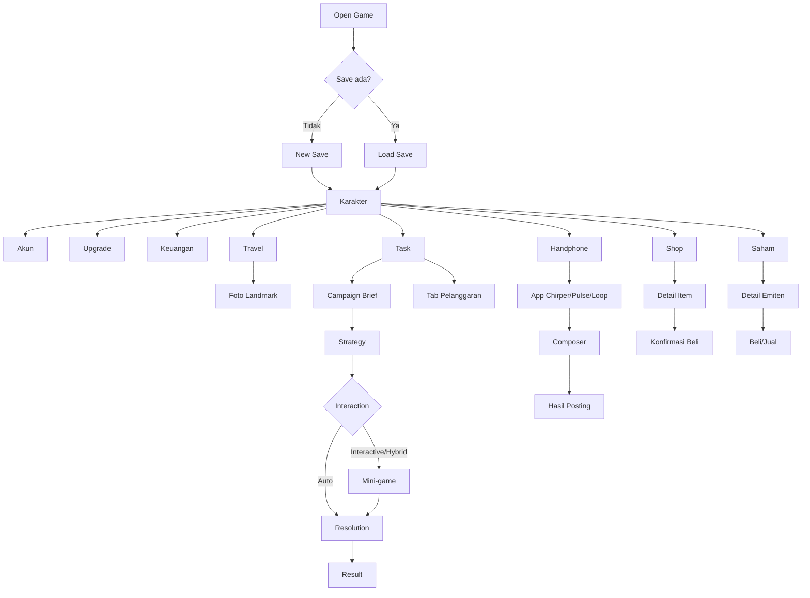

# PRODUCT REQUIREMENTS DOCUMENT (PRD)
# MENJADI BUZZER — v2.0

**Status:** Draft — menggantikan PRD v1.0
**Versi:** 2.0
**Tanggal:** 26 November 2026
**Produk:** Menjadi Buzzer
**Platform:** Browser Game (Web)
**Mode:** Single-player
**Genre:** Semi Idle Management Simulation / Life Simulation / Strategy
**Dokumen acuan:** `project-overview/brainstorm.md` (immutable), GDD v1.0–v1.3, Tech Spec v1.0, PRD v1.0
**Referensi UI/visual:** `/ui-reference`

---

# 0. PERUBAHAN DARI v1.0

PRD v1.0 menetapkan MVP sempit: satu akun, passive income, automation, campaign, finance. Dokumen itu menempatkan shop, saham, properti, kendaraan, travel, dan lifestyle sebagai **Out of Scope**.

PRD v2.0 **memperluas MVP** agar sesuai ide awal di brainstorm: lima menu wajib, dengan handphone sebagai pusat gameplay.

| Aspek | v1.0 | v2.0 |
|---|---|---|
| Cakupan menu | 1 alur (Home/Akun/Upgrade/Campaign/Finance) | **5 menu: Karakter, Task, Handphone, Shop, Saham** |
| Sumber pendapatan | passive income + campaign | passive income + **posting manual** + campaign |
| Risk | suspicion sebagai statistik | **risk meter "Dicurigai"** yang menggerakkan penalti bertingkat |
| Ekonomi | uang untuk upgrade | uang untuk upgrade + **outfit, properti, kendaraan, tiket** |
| Progresi | followers/performance | + **koleksi aset, negara yang dikunjungi** |
| Navigasi | 5 tab fungsional | **5 tab brainstorm**; layar lama menjadi sub-menu |

Konsekuensi: scope MVP jauh lebih besar. Urutan eksekusi diatur di `development/plan-task-mvp.md`, bukan di dokumen ini.

---

# 1. TUJUAN DOKUMEN

PRD ini menerjemahkan ide brainstorm menjadi kebutuhan produk yang dapat diimplementasikan: alur pengguna, perilaku sistem, kriteria penerimaan, dan batas scope.

MVP dinyatakan berhasil bila pemain dapat:

1. Membuka game dan melihat karakter sendiri.
2. Menghasilkan uang pasif dari akun media sosial selama game terbuka.
3. Memposting konten secara manual lewat handphone untuk pendapatan tambahan, dengan risiko suspicion naik.
4. Mengambil kontrak kampanye dari menu Task untuk pendapatan besar berisiko.
5. Membelanjakan uang di Shop: pakaian, properti, kendaraan, tiket.
6. Terbang ke negara lain dan berfoto di landmark sebagai bukti pencapaian.
7. Membeli dan menjual saham fiktif.
8. Melihat akibat penalti saat suspicion terlalu tinggi: peringatan, shadowban, denda, sampai penyitaan aset.
9. Progres tersimpan lokal dan tidak terduplikasi setelah refresh.

## 1.1 Cara Membaca

- **MUST** — wajib ada agar MVP diterima.
- **SHOULD** — penting, boleh ditunda bila ada kendala yang disetujui.
- **COULD** — peningkatan setelah core stabil.
- **Out of Scope** — tidak dikerjakan tanpa perubahan scope resmi.
- Semua angka adalah **placeholder konfigurasi**, bukan balancing final.

## 1.2 Urutan Sumber Kebenaran

1. **Brainstorm** — immutable, tidak boleh diubah.
2. **GDD v1.0–v1.3** — aturan gameplay, core loop, progression.
3. **PRD ini** — kebutuhan produk, scope, acceptance criteria.
4. **Tech Spec** — keputusan implementasi teknis.

Jika ada konflik antara GDD (yang menetapkan MVP sempit) dan PRD v2.0 (yang memperluas), **PRD v2.0 menang untuk scope**, sedangkan **GDD menang untuk aturan mekanik** (formula income, probability, penalty).

---

# 2. PRODUCT OVERVIEW

## 2.1 Product Summary

Menjadi Buzzer adalah simulasi karier buzzer media sosial. Pemain mengelola karakter, akun media sosial fiktif, dan bisnis konten. Uang datang dari tiga jalur: pendapatan pasif akun, posting manual lewat handphone, dan kontrak kampanye. Uang dipakai untuk meningkatkan akun, membeli penampilan dan aset, serta bepergian.

Setiap kenaikan pendapatan menaikkan pula risiko. Suspicion yang menumpuk memicu peringatan, penurunan jangkauan, denda, hingga penyitaan aset.

## 2.2 Product Vision

Memberi pengalaman "kaya tapi ada harganya": pemain merasakan pertumbuhan ekonomi yang nyata, punya kebebasan membelanjakan hasilnya, dan terus menghitung untung-rugi antara satu posting lagi atau berhenti.

## 2.3 Product Goals

| ID | Goal | Indikator keberhasilan MVP |
|---|---|---|
| PG-01 | Core Semi Idle terbukti | Pendapatan berjalan tanpa input berulang |
| PG-02 | Handphone terasa sebagai inti | Pemain bisa posting, melihat hasil, dan merasakan risiko dalam < 1 menit |
| PG-03 | Ekonomi punya tujuan belanja | Minimal 4 kategori Shop berfungsi dan memengaruhi tampilan atau status |
| PG-04 | Risiko terbaca dan bertingkat | Risk meter terlihat; minimal 3 tingkat penalti dapat terjadi |
| PG-05 | Progresi terasa | Pemain dapat membuka negara baru dan memajang hasil |
| PG-06 | Investasi punya kedalaman | Saham bisa dibeli/dijual dengan harga bergerak |
| PG-07 | Progres aman | Save lokal, schema version, tanpa duplikasi transaksi |
| PG-08 | Fondasi ekspansi | Data dan config terpisah dari UI |

## 2.4 Non-Goals

MVP tidak bertujuan untuk:

- Multiplayer, leaderboard online, atau berbagi ke pemain lain (butuh backend).
- Integrasi media sosial nyata atau API platform asli.
- Menyalin aset, logo, karakter, atau nama merek nyata.
- Ekonomi final yang seimbang untuk seluruh durasi permainan.
- Sistem agensi dan staf kompleks.
- Game Over permanen (kebangkrutan total) — di luar MVP.

## 2.5 Nada dan Batas Konten

- **Satir, bukan panduan.** Game menggambarkan konsekuensi nyata dari perilaku buzzer.
- Semua klien, merek, produk, tokoh, partai, dan kasus **fiktif**.
- Nama platform medsos adalah parodi fiktif (`Chirper`, `Pulse`, `Loop`), bukan merek asli.
- Tidak ada konten politik nyata, tokoh nyata, atau kasus nyata.

---

# 3. TARGET USER & EXPERIENCE PRINCIPLES

## 3.1 Target Player

Pemain game manajemen ringan, idle/incremental, dan simulasi bisnis yang menyukai pilihan risiko-reward serta progres koleksi.

## 3.2 Player Needs

- Memahami dalam beberapa detik apa yang menghasilkan uang.
- Melihat progres walau tidak menekan tombol terus.
- Punya alasan jelas untuk membelanjakan uang.
- Merasakan risiko yang bisa dikendalikan, bukan hukuman acak.
- Tidak kehilangan progres karena refresh.

## 3.3 Experience Principles

1. **Handphone first.** Posting manual adalah aktivitas inti, bukan pelengkap.
2. **Idle tetap hidup.** Passive income berjalan tanpa input.
3. **Risk is legible.** Suspicion terlihat, penyebabnya jelas, penaltinya bertingkat.
4. **Randomness is fair.** Hasil tidak berubah karena refresh.
5. **Progress is visible.** Saldo, income, level, aset, dan negara terlihat.
6. **Low friction.** Lima menu utama selalu satu ketukan.
7. **Satir, bukan glorifikasi.** Konsekuensi selalu ditampilkan.

---

# 4. MVP SCOPE — LIMA MENU

## 4.1 Peta Menu

| Menu | Nama layar | Isi utama | Sub-layar |
|---|---|---|---|
| 1 | **Karakter** | Karakter pemain, outfit terpasang, saldo, risk meter, travel | Akun, Upgrade, Keuangan, Travel, Detail Aset |
| 2 | **Task** | Daftar task & kontrak, detail task, tab Pelanggaran | Campaign Brief, Strategy, Mini-game, Result, Penalti |
| 3 | **Handphone** | Daftar app medsos fiktif, composer posting, feed | Compose (caption/hashtag/jam), Hasil Posting |
| 4 | **Shop** | Pakaian, properti, kendaraan, tiket | Detail item, Konfirmasi beli |
| 5 | **Saham** | Daftar emiten fiktif, harga, portofolio | Detail emiten, Beli/Jual |

## 4.2 Menu 1 — Karakter (MUST)

- Karakter 2D modular berbasis SVG layer.
- Outfit yang sudah dibeli dapat dipasang/dilepas.
- Saldo dan income rate terlihat.
- **Risk meter "Dicurigai"** dengan label dan segmen.
- Tombol travel: pilih negara; negara terkunci bila tiket belum dibeli.
- Shortcut ke Akun, Upgrade, Keuangan.

## 4.3 Menu 2 — Task (MUST)

- Daftar task: kontrak kampanye (Auto/Interactive/Hybrid) dan task harian sederhana.
- Detail task: klien, tujuan, reward, bonus, difficulty, risk, interaction type.
- Alur kontrak: Accept → Strategy → Activity/Auto → Result.
- **Tab Pelanggaran**: riwayat penalti (denda, shadowban, penyitaan) beserta penyebab.
- Tab Pelanggaran juga menampilkan aturan penalti bertingkat agar pemain memahami konsekuensi.

## 4.4 Menu 3 — Handphone (MUST)

- Wadah visual ponsel berisi daftar app medsos fiktif: `Chirper`, `Pulse`, `Loop`.
- Membuka app menampilkan feed + tombol Posting.
- **Composer**: pilih caption, hashtag, dan jam posting dari opsi terbatas.
- Setiap posting menghasilkan engagement, followers kecil, dan uang kecil; menaikkan suspicion.
- Hasil posting ditampilkan singkat (engagement, followers, uang, suspicion delta).
- Posting punya cooldown agar bukan tombol spam.
- Risk meter terlihat di layar handphone.

## 4.5 Menu 4 — Shop (MUST)

Empat kategori:

| Kategori | Isi | Efek |
|---|---|---|
| Pakaian | Outfit, aksesori | Mengubah tampilan karakter; sebagian memberi bonus kredibilitas kecil |
| Properti | Rumah/kantor bertingkat | Menambah kapasitas atau bonus income kecil |
| Kendaraan | Kendaraan fiktif | Status/prestise; sebagian menambah bonus kecil |
| Tiket | Tiket negara | Membuka travel ke negara tersebut |

- Setiap item: nama, harga, deskripsi, status (belum dimiliki / dimiliki / terpasang).
- Pembelian divalidasi saldo, atomik, tercatat di Keuangan.

## 4.6 Menu 5 — Saham (MUST)

- Beberapa emiten fiktif dengan harga bergerak (seeded random + event kecil).
- Beli/jual dengan jumlah lembar.
- Portofolio: lembar dimiliki, nilai pasar, untung/rugi.
- Harga bergerak hanya saat game terbuka (konsisten dengan kebijakan waktu).
- Semua transaksi saham tercatat di Keuangan.

## 4.7 Travel (MUST, di dalam Karakter)

- Daftar negara; terkunci bila tiket belum dibeli.
- Terbang ke negara yang terbuka: memindahkan lokasi aktif karakter.
- Berfoto di landmark: menghasilkan gambar komposisi (karakter + landmark SVG) yang dapat diunduh.
- Negara yang pernah dikunjungi tercatat sebagai koleksi.
- Travel tidak memerlukan backend; berbagi ke pemain lain Out of Scope.

## 4.8 Should Have

- Task harian sederhana (login harian, posting N kali).
- Animasi ringan untuk income, reward, penalti.
- Indikator perubahan statistik sebelum/sesudah campaign.
- Konfirmasi untuk keputusan berisiko tinggi.
- Empty state, error state, feedback konsisten.
- Reset save khusus build dev.

## 4.9 Could Have

- Partial Success outcome.
- Mini-game kedua (sudah diputuskan masuk — lihat D-01).
- Career XP sederhana.
- Prestise/level tampilan karakter.

## 4.10 Out of Scope

- Backend, login, cloud save, multiplayer, leaderboard online.
- Berbagi foto ke pemain lain atau galeri bersama.
- Integrasi media sosial nyata.
- Sistem agensi dan staf kompleks.
- Game Over permanen.
- Simulasi offline earning.
- Kustomisasi wajah/rambut detail di luar layer outfit.

---

# 5. INFORMATION ARCHITECTURE

## 5.1 Navigasi Utama — 5 Tab

```text
[ Karakter ] [ Task ] [ Handphone ] [ Shop ] [ Saham ]
```

- Selalu terlihat di semua layar utama.
- Tab aktif diberi `aria-current="page"`.
- Layar mini-game dan onboarding boleh menyembunyikan nav sementara.

## 5.2 Peta Navigasi



## 5.3 Aturan Navigasi

- Kembali ke Karakter dari seluruh sub-layar.
- Perpindahan layar tidak menghapus campaign session, draft posting, atau state saham.
- Result campaign dapat dibuka ulang dari Task tanpa menerapkan reward ulang.
- Tab Pelanggaran read-only.
- Jangan menampilkan menu palsu yang terlihat aktif tapi tidak berfungsi.

---

# 6. FUNCTIONAL REQUIREMENTS

## 6.1 Player, Save, Karakter

| ID | Prioritas | Requirement | Acceptance Criteria |
|---|---|---|---|
| FR-001 | MUST | Buat state awal bila belum ada save | Game terbuka tanpa error, tampil Karakter dengan 1 akun, saldo awal, 1 outfit dasar |
| FR-002 | MUST | Muat save valid saat dibuka ulang | Saldo, akun, upgrade, outfit, aset, saham, negara, transaksi kembali |
| FR-003 | MUST | Nilai awal dari konfigurasi | Tidak tersebar/hardcode |
| FR-004 | SHOULD | Reset save untuk testing | Konfirmasi, kembali ke starting state |
| FR-005 | MUST | Karakter tampil dengan outfit terpasang | Layer SVG tersusun sesuai item yang dipakai |
| FR-006 | MUST | Pemain dapat mengganti outfit yang dimiliki | Perubahan tersimpan dan terlihat langsung |

## 6.2 Passive Income

| ID | Prioritas | Requirement | Acceptance Criteria |
|---|---|---|---|
| FR-010 | MUST | Income dari elapsed time | Konsisten di berbagai frame rate |
| FR-011 | MUST | Followers & performance memengaruhi income | Perubahan salah satu mengubah rate |
| FR-012 | MUST | Automation multiplier memengaruhi income | Upgrade menaikkan rate |
| FR-013 | MUST | Income hanya saat game terbuka | Tidak ada income untuk waktu tertutup |
| FR-014 | MUST | Throttling browser tidak membuat drift | Delta dihitung saat update berikutnya |
| FR-015 | MUST | Formula terpusat di satu modul | UI tidak menduplikasi formula |
| FR-016 | MUST | Navigasi tidak mereset/menggandakan income | Total konsisten |
| FR-017 | SHOULD | Income tampil responsif | Update pada interval wajar |

## 6.3 Akun & Upgrade

| ID | Prioritas | Requirement | Acceptance Criteria |
|---|---|---|---|
| FR-020 | MUST | Satu akun awal dengan statistik lengkap | followers, performance, reputation, suspicion, status, automationLevel |
| FR-021 | MUST | Layar Akun memisahkan followers & performance | Menjelaskan kontribusi keduanya |
| FR-022 | MUST | Akun menampilkan reputation, suspicion, status | Nilai mengikuti state |
| FR-023 | SHOULD | Perubahan statistik ditampilkan setelah campaign | Delta, bukan hanya nilai akhir |
| FR-024 | MUST | Status akun memodifikasi income/aktivitas | Diterapkan game logic, bukan label UI |
| FR-030 | MUST | Upgrade automation beberapa level | Level sekarang & berikutnya terlihat |
| FR-031 | MUST | Upgrade menampilkan nama, deskripsi, harga, efek | Sebelum membeli |
| FR-032 | MUST | Validasi saldo sebelum beli | Ditolak bila kurang |
| FR-033 | MUST | Pembelian memotong saldo satu kali | Double-click/refresh tidak menggandakan |
| FR-034 | MUST | Upgrade menaikkan multiplier | Rate berubah |
| FR-035 | MUST | Upgrade tersimpan setelah refresh | Level & saldo konsisten |
| FR-036 | SHOULD | Preview rate sebelum/sesudah | Pemain paham manfaat |
| FR-037 | MUST | Harga & efek dari konfigurasi | Balancing tanpa edit UI |

## 6.4 Posting Manual (Handphone)

| ID | Prioritas | Requirement | Acceptance Criteria |
|---|---|---|---|
| FR-040 | MUST | Handphone menampilkan daftar app medsos fiktif | Minimal 2 app dapat dibuka |
| FR-041 | MUST | Composer menyediakan pilihan caption | Opsi terbatas, dari data |
| FR-042 | MUST | Composer menyediakan pilihan hashtag | Opsi terbatas |
| FR-043 | MUST | Composer menyediakan pilihan jam posting | Quiet/Normal/Peak |
| FR-044 | MUST | Posting menghasilkan engagement & uang kecil | Nominal dari konfigurasi |
| FR-045 | MUST | Posting menaikkan suspicion | Delta dari konfigurasi |
| FR-046 | MUST | Posting menaikkan followers kecil | Delta dari konfigurasi |
| FR-047 | MUST | Hasil posting ditampilkan | Engagement, followers, uang, suspicion |
| FR-048 | MUST | Posting punya cooldown | Tidak bisa spam beruntun |
| FR-049 | MUST | Posting tercatat di Keuangan | Tipe transaksi `posting_income` |
| FR-050 | SHOULD | Kesesuaian caption+hashtag+jam memengaruhi hasil | Kombinasi buruk menghasilkan lebih sedikit |
| FR-051 | SHOULD | Risk meter terlihat di layar handphone | Label + segmen |

## 6.5 Campaign (Task)

| ID | Prioritas | Requirement | Acceptance Criteria |
|---|---|---|---|
| FR-060 | MUST | Task menampilkan kontrak tersedia | Nama, klien, difficulty, payment, bonus, risk, interaction |
| FR-061 | MUST | Detail kontrak lengkap | Semua info sebelum menerima |
| FR-062 | MUST | Terima kontrak eligible | Membuat session |
| FR-063 | MUST | Tolak terima ganda | Kontrak yang sudah diterima tidak bisa diterima lagi |
| FR-064 | MUST | Data kontrak terpisah dari UI | Dapat ditambah lewat data |
| FR-065 | MUST | Interaction type Auto/Interactive/Hybrid | Menentukan alur |
| FR-070 | MUST | Pilih strategi sebelum resolve | Tersimpan di session |
| FR-071 | MUST | Strategi memengaruhi performance & probability | Perubahan input kalkulasi |
| FR-072 | MUST | Pilih intensity/risk posture | Diterapkan sesuai kontrak |
| FR-073 | MUST | Tampilkan estimasi reward & risk indicator | Trade-off jelas |
| FR-074 | MUST | Hanya parameter relevan yang ditampilkan | Tidak memaksa semua |
| FR-075 | SHOULD | Peringatan kondisi akun | Muncul bila suspicion/status berisiko |
| FR-080 | MUST | Minimal satu mini-game | Kontrak Interactive/Hybrid membukanya |
| FR-081 | MUST | Mini-game menghasilkan skor | Tersimpan di session |
| FR-082 | MUST | Skor menjadi input resolusi | Mengubah modifier, bukan jaminan |
| FR-083 | MUST | Kontrak Auto tidak memaksa mini-game | Langsung resolusi |
| FR-084 | MUST | Mini-game tidak bisa diulang gratis | Refresh tidak memberi attempt baru |
| FR-085 | SHOULD | Dukung mouse dan touch | Desktop & mobile |
| FR-090 | MUST | Performance score terpisah dari probability | Skor tinggi tidak otomatis sukses |
| FR-091 | MUST | Probability dipengaruhi data & keputusan | Faktor relevan masuk kalkulasi |
| FR-092 | MUST | Satu random roll per campaign | Tidak berubah setelah refresh |
| FR-093 | MUST | Minimal Success & Failure | Keduanya teruji |
| FR-094 | MUST | Validasi state sebelum resolve | Tidak ada resolve ganda |
| FR-095 | MUST | Snapshot hasil disimpan | Outcome, roll, probability, score, reward, penalty |
| FR-096 | MUST | Reward/penalty diterapkan tepat sekali | Refresh tidak mengulang |
| FR-100 | MUST | Success memberi base payment | Saldo bertambah sesuai hasil |
| FR-101 | MUST | Bonus sesuai aturan target | Dicatat terpisah |
| FR-102 | MUST | Failure dapat mengurangi/meniadakan pembayaran | Sesuai consequence profile |
| FR-103 | MUST | Failure dapat menerapkan denda & penurunan reputasi | Minimal satu skenario |
| FR-104 | MUST | Suspicion diperbarui | Sesuai konfigurasi |
| FR-105 | SHOULD | Restriction dasar dapat diterapkan | Status berubah, modifier ikut |
| FR-106 | MUST | Tidak semua failure menerapkan semua konsekuensi | Dipilih dari severity |
| FR-107 | SHOULD | Result menjelaskan konsekuensi | Pemain tahu denda & delta |

## 6.6 Risk Meter & Penalti Bertingkat

| ID | Prioritas | Requirement | Acceptance Criteria |
|---|---|---|---|
| FR-110 | MUST | Risk meter "Dicurigai" tampil di Karakter & Handphone | Nilai 0–100 dengan label tingkat |
| FR-111 | MUST | Tingkat: Aman / Waspada / Panas / Kritis | Threshold dari konfigurasi |
| FR-112 | MUST | Tingkat memicu konsekuensi bertingkat | Lihat tabel di bawah |
| FR-113 | MUST | Tab Pelanggaran menampilkan riwayat penalti | Tanggal, jenis, penyebab, nominal |
| FR-114 | MUST | Tab Pelanggaran menampilkan aturan penalti | Pemain paham sebelum kena |
| FR-115 | MUST | Suspicion turun saat istirahat dari posting | Cooldown menurunkan suspicion perlahan |
| FR-116 | SHOULD | Ada aksi pemulihan berbayar | Menurunkan suspicion dengan biaya |
| FR-117 | MUST | Penyitaan aset hanya pada tingkat Kritis | Aset terpilih disita, tercatat di Pelanggaran |

### 6.6.1 Tabel Penalti Bertingkat (placeholder)

| Tingkat | Suspicion | Efek |
|---|---|---|
| Aman | 0–29 | Tidak ada |
| Waspada | 30–59 | Income −10%, peringatan di UI |
| Panas | 60–84 | Income −35%, shadowban: posting tidak menghasilkan followers, denda otomatis |
| Kritis | 85–100 | Income −70%, akun restricted, risiko penyitaan satu aset |

## 6.7 Shop

| ID | Prioritas | Requirement | Acceptance Criteria |
|---|---|---|---|
| FR-120 | MUST | Shop punya 4 kategori: Pakaian, Properti, Kendaraan, Tiket | Masing-masing dapat dibuka |
| FR-121 | MUST | Setiap item menampilkan nama, harga, deskripsi | Sebelum membeli |
| FR-122 | MUST | Pembelian divalidasi saldo | Ditolak bila kurang |
| FR-123 | MUST | Pembelian atomik & sekali | Double-click tidak menggandakan |
| FR-124 | MUST | Pembelian tercatat di Keuangan | Tipe `shop_purchase` |
| FR-125 | MUST | Item yang dimiliki tidak bisa dibeli ulang | Status "Dimiliki" |
| FR-126 | MUST | Pakaian dapat dipasang ke karakter | Tampilan berubah |
| FR-127 | MUST | Tiket membuka negara terkait | Negara terbuka di Travel |
| FR-128 | MUST | Properti/kendaraan memberi efek terukur | Bonus dari konfigurasi |
| FR-129 | SHOULD | Filter/sort per kategori | Membantu bila item banyak |

## 6.8 Saham

| ID | Prioritas | Requirement | Acceptance Criteria |
|---|---|---|---|
| FR-130 | MUST | Daftar emiten fiktif dengan harga | Minimal 3 emiten |
| FR-131 | MUST | Harga bergerak saat game terbuka | Seeded, bukan acak murni |
| FR-132 | MUST | Beli saham dengan jumlah lembar | Saldo berkurang sesuai harga |
| FR-133 | MUST | Jual saham yang dimiliki | Saldo bertambah sesuai harga |
| FR-134 | MUST | Portofolio menampilkan lembar, nilai, untung/rugi | Nilai mengikuti harga terbaru |
| FR-135 | MUST | Transaksi saham tercatat di Keuangan | Tipe `stock_buy` / `stock_sell` |
| FR-136 | MUST | Tidak bisa menjual lebih dari yang dimiliki | Ditolak |
| FR-137 | SHOULD | Grafik harga sederhana | Riwayat harga terbatas |
| FR-138 | MUST | Harga tidak bergerak saat game tertutup | Konsisten dengan kebijakan waktu |

## 6.9 Travel

| ID | Prioritas | Requirement | Acceptance Criteria |
|---|---|---|---|
| FR-140 | MUST | Daftar negara | Minimal 5 negara |
| FR-141 | MUST | Negara terkunci bila tiket belum dibeli | Alasan ditampilkan |
| FR-142 | MUST | Terbang memindahkan lokasi aktif | Lokasi tampil di Karakter |
| FR-143 | MUST | Foto di landmark menghasilkan komposisi | Karakter + landmark SVG |
| FR-144 | MUST | Foto dapat diunduh | Format gambar, tanpa server |
| FR-145 | MUST | Negara yang dikunjungi tercatat | Koleksi terlihat |
| FR-146 | SHOULD | Biaya perjalanan per negara | Dari konfigurasi |

## 6.10 Keuangan

| ID | Prioritas | Requirement | Acceptance Criteria |
|---|---|---|---|
| FR-150 | MUST | Keuangan menampilkan saldo | Sama dengan player state |
| FR-151 | MUST | Mencatat passive income | Terlihat di history |
| FR-152 | MUST | Mencatat posting income | Dengan referensi app |
| FR-153 | MUST | Mencatat campaign payment & bonus | Dengan referensi campaign |
| FR-154 | MUST | Mencatat upgrade purchase | Dengan referensi upgrade |
| FR-155 | MUST | Mencatat fine/penalty | Sebagai pengeluaran |
| FR-156 | MUST | Mencatat shop purchase | Dengan referensi item |
| FR-157 | MUST | Mencatat transaksi saham | Beli/jual dengan referensi emiten |
| FR-158 | MUST | Setiap transaksi punya ID unik & waktu | Tidak ada duplikat |
| FR-159 | SHOULD | Filter berdasarkan tipe | Memudahkan pembacaan |

## 6.11 Persistence & Integritas

| ID | Prioritas | Requirement | Acceptance Criteria |
|---|---|---|---|
| FR-160 | MUST | Save lokal dengan schema version | Bisa dimigrasi |
| FR-161 | MUST | Setiap entity punya ID stabil | Tidak tabrakan |
| FR-162 | MUST | Campaign resolved tidak bisa resolved lagi | Ditolak |
| FR-163 | MUST | Random roll tersimpan | Tidak berubah setelah refresh |
| FR-164 | MUST | Reward/penalty/denda diterapkan sekali | Idempoten |
| FR-165 | MUST | Income tidak dihitung ulang pada interval sama | Tidak dobel |
| FR-166 | MUST | Save corrupt ditangani tanpa silent overwrite | Recovery path jelas |

---

# 7. SCREEN-LEVEL REQUIREMENTS

## 7.1 Karakter

- Karakter besar dengan outfit terpasang.
- Saldo, income rate.
- Risk meter dengan label tingkat.
- Lokasi aktif (negara).
- Tombol: Travel, Akun, Upgrade, Keuangan.
- State: new save, normal, utang, restricted, loading.

## 7.2 Task

- Daftar task/kontrak dengan status.
- Kartu: nama, klien, difficulty, payment, bonus, risk, interaction.
- Tab: Kontrak | Pelanggaran.
- State: kosong, eligible, ineligible (+alasan), accepted, selesai.

## 7.3 Campaign Brief / Strategy / Mini-game / Result

Mengikuti PRD v1.0 §7.5–7.8 dengan penambahan:
- Brief menampilkan dampak terhadap risk meter.
- Result menampilkan delta suspicion dan apakah memicu tingkat baru.

## 7.4 Handphone

- Bingkai ponsel.
- Daftar app: Chirper, Pulse, Loop (ikon + nama fiktif).
- Feed ringkas per app.
- Tombol Posting membuka composer.
- Risk meter ringkas di header ponsel.
- State: cooldown aktif, shadowban aktif.

## 7.5 Composer

- Pilih caption (3–4 opsi).
- Pilih hashtag (3–4 opsi).
- Pilih jam posting (Quiet/Normal/Peak).
- Preview estimasi hasil kualitatif (bukan angka presisi).
- Tombol Posting (disabled saat cooldown).

## 7.6 Hasil Posting

- Engagement, followers delta, uang, suspicion delta.
- Feedback visual berbeda untuk hasil bagus/buruk.
- Tombol kembali ke feed.

## 7.7 Shop

- Tab kategori: Pakaian, Properti, Kendaraan, Tiket.
- Kartu item: gambar, nama, harga, status.
- Detail item + tombol beli.
- State: dimiliki, terpasang, tidak mampu, terkunci.

## 7.8 Saham

- Daftar emiten: nama fiktif, harga, perubahan persen.
- Detail: grafik sederhana, lembar dimiliki, tombol beli/jual.
- Portofolio ringkas di atas.
- State: kosong, memiliki saham, untung, rugi.

## 7.9 Travel

- Daftar negara: nama, landmark, status (terkunci/terbuka/dikunjungi).
- Tombol terbang (butuh tiket).
- Layar foto: karakter + landmark, tombol unduh.

## 7.10 Keuangan

Mengikuti PRD v1.0 §7.9 dengan 9 tipe transaksi.

---

# 8. DATA & STATE

## 8.1 Tambahan Struktur Data (dari v1.0)

```jsonc
{
  "character": {
    "outfitId": "outfit-basic",
    "accessoryIds": [],
    "locationCountryId": "id",
    "visitedCountryIds": ["id"]
  },
  "inventory": {
    "ownedItemIds": ["outfit-basic"],
    "equipped": { "outfit": "outfit-basic", "accessory": null }
  },
  "assets": {
    "ownedPropertyIds": [],
    "ownedVehicleIds": []
  },
  "tickets": { "ownedCountryIds": [] },
  "stocks": {
    "holdings": [{ "ticker": "NUSA", "shares": 10, "avgCost": 120 }],
    "priceHistory": { "NUSA": [{ "at": 0, "price": 120 }] },
    "seed": 12345
  },
  "social": {
    "cooldownUntil": null,
    "postingCount": 0,
    "shadowbannedUntil": null
  },
  "violations": [
    { "id": "v_1", "kind": "fine", "amount": 50, "reason": "suspicion_high", "at": 0 }
  ],
  "riskTier": "safe"
}
```

## 8.2 Domain Separation

Pisahkan: player/economy, account, income, upgrade, campaign, strategy, risk, penalty, finance, **posting**, **shop**, **stocks**, **travel**, **character**, persistence.

UI tidak boleh menjadi tempat formula ekonomi, probability, atau mutasi data.

## 8.3 Integritas

- Semua entity ID stabil.
- Setiap transaksi ID unik + `balanceAfter`.
- Campaign resolved tidak bisa resolved lagi.
- Random roll disimpan.
- Reward/penalty/denda sekali.
- Pembelian shop/stok atomik.
- Income tidak dihitung ulang pada interval sama.
- Save schema version.

## 8.4 Persistence

`localStorage`, key `menjadiBuzzer.save.v1`, envelope dengan `appId`, `schemaVersion`, `savedAt`, `payload`.

Simpan setelah: income flush, upgrade purchase, campaign accept/strategy/mini-game/resolve, posting, shop purchase, stock trade, travel, penalti.

Save corrupt: jangan crash, jangan timpa, tampilkan recovery.

---

# 9. CONFIGURATION

Semua nilai di `src/data/config/`:

- Starting player/account/character.
- Base income rate, follower/performance curve, cap.
- Automation multiplier & cost.
- Posting: opsi caption/hashtag/jam, reward range, suspicion delta, cooldown, follower delta.
- Campaign: payment, bonus, base risk, base probability.
- Strategy modifiers.
- Mini-game scoring weights.
- Probability clamp.
- Penalty: fine, reputation, suspicion, **tier thresholds**, **shadowban duration**, **asset seizure rule**.
- Status modifiers.
- Shop: item catalog, harga, efek.
- Stocks: emiten, harga awal, volatilitas, event.
- Travel: negara, biaya, landmark.
- Recovery: biaya, pengurangan suspicion.

---

# 10. UI, VISUAL, ART

## 10.1 Referensi Wajib

`/ui-reference` — 54 screenshot. Wajib dipelajari sebelum membuat/mengubah UI. Jangan menyalin aset, logo, karakter, atau identitas.

## 10.2 Prinsip

- Hierarki saldo, income, risk meter jelas.
- Risk meter selalu terbaca: warna + label + segmen.
- Kartu/panel mengelompokkan informasi.
- Feedback Success/Failure/Penalty berbeda dan jelas.
- Karakter tampil dominan di menu Karakter.
- Handphone terasa seperti perangkat, bukan sekadar daftar.

## 10.3 Responsif

- Potret sebagai basis, kolom terpusat maks 480 px.
- Desktop menambah padding/background, bukan mengubah komposisi.
- Touch target ≥ 44 px.

## 10.4 State Wajib

Default, loading, disabled, empty, error, success/failure feedback.

---

# 11. NON-FUNCTIONAL

- Responsif di desktop & mobile modern.
- Income update tidak memicu render per frame.
- Refresh tidak menghapus progres.
- Navigasi tidak mereset state.
- Error pada satu campaign/saham tidak merusak save.
- Mendukung Chromium, Firefox, Safari.
- Input mouse, keyboard dasar, touch.
- Kontras cukup; status tidak hanya warna.
- Tanpa data pribadi, tanpa kredensial medsos asli, tanpa secret di client.

---

# 12. ERROR HANDLING

| ID | Kondisi | Perilaku |
|---|---|---|
| EC-01 | Saldo kurang saat beli | Ditolak, saldo tetap, alasan tampil |
| EC-02 | Klik beli berulang | Satu pembelian |
| EC-03 | Campaign sudah accepted | Accept berikutnya ditolak |
| EC-04 | Campaign sudah resolved | Resolve ditolak, result lama tampil |
| EC-05 | Refresh saat campaign berjalan | Session dipulihkan |
| EC-06 | Refresh setelah mini-game | Skor tersimpan |
| EC-07 | Refresh pada result | Result sama, tanpa reward ulang |
| EC-08 | Tab inactive/throttled | Elapsed time dihitung saat update |
| EC-09 | Game ditutup lalu dibuka | Tidak ada offline income |
| EC-10 | Save corrupt | Error + recovery, tanpa crash |
| EC-11 | Config tidak lengkap | Item tidak dimainkan, log jelas |
| EC-12 | Denda > saldo | Saldo boleh negatif (utang), tanpa NaN |
| EC-13 | Income sangat kecil | Presisi dipertahankan, tampilan dibulatkan |
| EC-14 | Pindah layar saat income berjalan | Konsisten |
| EC-15 | Back saat mini-game/session aktif | Session tetap |
| EC-16 | Posting saat cooldown | Ditolak, sisa waktu tampil |
| EC-17 | Jual saham melebihi kepemilikan | Ditolak |
| EC-18 | Travel ke negara terkunci | Ditolak, alasan tampil |
| EC-19 | Penyitaan aset saat Kritis | Aset terpilih disita, tercatat, tidak menghapus save |
| EC-20 | Harga saham NaN/undefined | Guard, gunakan harga terakhir valid |

---

# 13. ACCEPTANCE CRITERIA

## 13.1 Karakter & Identitas
- [ ] Game terbuka tanpa save, karakter + outfit dasar tampil.
- [ ] Outfit yang dibeli dapat dipasang dan tersimpan.
- [ ] Risk meter tampil dengan label tingkat.

## 13.2 Passive Income
- [ ] Income bertambah saat game terbuka.
- [ ] Elapsed time, bukan frame count.
- [ ] Followers, performance, automation, status memengaruhi.
- [ ] Tidak ada offline income.
- [ ] Navigasi tidak menggandakan.

## 13.3 Posting Manual
- [ ] Minimal 2 app medsos dapat dibuka.
- [ ] Composer menyediakan caption, hashtag, jam.
- [ ] Posting menghasilkan engagement, followers, uang.
- [ ] Posting menaikkan suspicion.
- [ ] Cooldown mencegah spam.
- [ ] Posting tercatat di Keuangan.

## 13.4 Campaign
- [ ] Task menampilkan kontrak.
- [ ] Brief lengkap.
- [ ] Accept membuat session.
- [ ] Strategy + intensity dipilih.
- [ ] Auto tanpa mini-game; Interactive/Hybrid menjalankan mini-game.
- [ ] Satu random roll.
- [ ] Success & Failure teruji.

## 13.5 Risk & Penalti
- [ ] Tiga tingkat penalti dapat terjadi.
- [ ] Tab Pelanggaran menampilkan riwayat + aturan.
- [ ] Shadowban menurunkan output.
- [ ] Penyitaan aset hanya pada Kritis.
- [ ] Suspicion turun saat istirahat.

## 13.6 Shop
- [ ] Empat kategori berfungsi.
- [ ] Beli validasi saldo, atomik, tercatat.
- [ ] Tiket membuka negara.
- [ ] Pakaian mengubah tampilan.

## 13.7 Saham
- [ ] Minimal 3 emiten dengan harga bergerak.
- [ ] Beli/jual dengan validasi.
- [ ] Portofolio menampilkan untung/rugi.
- [ ] Tercatat di Keuangan.

## 13.8 Travel
- [ ] Minimal 5 negara, terkunci tanpa tiket.
- [ ] Terbang memindahkan lokasi.
- [ ] Foto landmark dapat diunduh.
- [ ] Koleksi negara tercatat.

## 13.9 Persistence
- [ ] Save/load lokal.
- [ ] Refresh tidak menghapus progres.
- [ ] Campaign in progress dapat dilanjutkan.
- [ ] Random roll tidak berubah.
- [ ] Tidak ada double purchase/reward/penalty.
- [ ] Schema version tersimpan.

## 13.10 UI
- [ ] 5 tab tersedia dan terhubung.
- [ ] UI mengacu `/ui-reference`, tanpa menyalin aset.
- [ ] Desktop & mobile usable tanpa overflow.
- [ ] Mouse & touch berfungsi di mini-game.

---

# 14. TESTING

## 14.1 Unit
Income, accrual, upgrade cost/effect, eligibility, transitions, strategy, performance, probability, resolve, penalty, **tier transition**, **posting reward**, **shop purchase**, **stock trade**, **travel unlock**, ledger, migration.

## 14.2 Integration
First launch → save → reload; accrual → purchase; posting → suspicion naik → tier berubah; accept → strategy → mini-game → resolve; shop buy → outfit terpasang; stock buy → harga naik → jual; travel → foto; refresh di tiap tahap.

## 14.3 Manual QA
1. Biarkan game berjalan, saldo bertambah.
2. Posting 5× beruntun, pastikan cooldown bekerja.
3. Naikkan suspicion sampai Panas, cek income turun.
4. Naikkan sampai Kritis, cek penyitaan aset.
5. Beli outfit, pasang, refresh.
6. Beli tiket, travel, foto, unduh.
7. Beli saham, tunggu harga bergerak, jual.
8. Refresh di setiap layar.
9. Uji desktop & mobile.

---

# 15. IMPLEMENTATION PRIORITY

1. Audit `/ui-reference` + fondasi (selesai).
2. Save/load + initial state (selesai).
3. Passive income engine (selesai).
4. Automation upgrade (selesai).
5. **Navigasi 5 tab + Karakter** (refactor).
6. **Handphone + posting manual + risk meter**.
7. Campaign (Task).
8. Mini-game + resolution.
9. Penalti bertingkat + Tab Pelanggaran.
10. Shop.
11. Saham.
12. Travel + foto.
13. Keuangan lengkap.
14. QA, responsive, balancing.

---

# 16. MILESTONES

| Milestone | Scope | Exit Criteria |
|---|---|---|
| M0 | Audit + plan | Tidak ada asumsi besar belum dilaporkan |
| M1 | Foundation + save | First launch & reload lulus |
| M2 | Idle economy | Income rules lulus |
| M3 | Automation | Purchase & persistence lulus |
| M4 | Nav 5 tab + Karakter | 5 tab berfungsi, karakter + outfit tampil |
| M5 | Handphone + posting | Posting, cooldown, suspicion naik |
| M6 | Campaign | Session valid & dapat dilanjutkan |
| M7 | Mini-game | Skor & auto flow lulus |
| M8 | Risk & Result | Tanpa reroll/double reward, 3 tier penalti |
| M9 | Shop | 4 kategori, tiket membuka negara |
| M10 | Saham | Beli/jual, portofolio, harga bergerak |
| M11 | Travel | Terbang, foto, koleksi |
| M12 | Keuangan + QA | Seluruh MUST lulus |

---

# 17. OPEN DECISIONS

| ID | Area | Baseline | Catatan |
|---|---|---|---|
| OD-01 | Income crediting | Auto-credit (pending → flush) | Sudah diimplementasikan; pending diakumulasi lalu dikreditkan saat flush agar ledger konsisten |
| OD-02 | Mini-game | Dua: Caption + Engagement | Disetujui |
| OD-03 | Outcomes | Success & Failure | Partial opsional |
| OD-04 | Economy values | Semua dari config | Perlu playtesting |
| OD-05 | Probability | Formula konseptual + satu roll | Bobot belum final |
| OD-06 | Strategy options | Hanya parameter relevan | Set final menunggu seed |
| OD-07 | Penalty mapping | Hybrid per severity | Threshold belum final |
| OD-08 | Restriction | Status dasar disiapkan | Wajib di v2.0 |
| OD-09 | Campaign catalog | Seed beberapa kontrak | Nama & nilai belum final |
| OD-10 | Tech stack | Vite + TS + vanilla DOM/SVG | Sudah berjalan |
| OD-11 | Offline earnings | Tidak termasuk | Arsitektur tidak menghalangi |
| OD-12 | Multi-account/agency | Tidak termasuk | Ekspansi pasca-MVP |
| **OD-13** | **Nama app medsos** | `Chirper`, `Pulse`, `Loop` | Parodi fiktif; final saat desain konten |
| **OD-14** | **Daftar negara** | 5 negara placeholder | Landmark SVG original |
| **OD-15** | **Emiten saham** | 3–5 emiten fiktif | Nama final saat desain konten |
| **OD-16** | **Mekanik foto** | Komposisi SVG + unduh PNG | Tanpa server |
| **OD-17** | **Cooldown posting** | 60 detik placeholder | Perlu playtesting |
| **OD-18** | **Penyitaan aset** | 1 aset acak saat Kritis | Perlu aturan final agar tidak menghukum terlalu keras |

---

# 18. DEFINITION OF DONE

1. Pemain membuka game, melihat karakter dengan outfit.
2. Akun menghasilkan passive income selama game terbuka.
3. Income dipengaruhi followers, performance, automation, status.
4. Pemain dapat posting manual lewat handphone dengan risiko suspicion.
5. Risk meter memicu minimal 3 tingkat penalti.
6. Pemain dapat menerima dan menyelesaikan kontrak.
7. Strategi, intensitas, dan mini-game memengaruhi hasil.
8. Sistem menghitung performance, probability, satu random outcome.
9. Reward/penalty diterapkan sekali dan dapat dibuka ulang.
10. Shop 4 kategori berfungsi, tiket membuka negara.
11. Saham dapat dibeli/dijual dengan harga bergerak.
12. Travel + foto landmark berfungsi, koleksi tercatat.
13. Keuangan mencatat seluruh 9 tipe transaksi.
14. Save lokal aman, tanpa duplikasi.
15. 5 tab + seluruh layar usable di desktop & mobile.
16. UI original, mengacu `/ui-reference` tanpa menyalin.
17. Seluruh acceptance criteria MUST lulus.

---

# 19. CHANGE LOG

| Versi | Tanggal | Perubahan |
|---|---|---|
| 1.0 | 26 Nov 2026 | PRD pertama berdasarkan GDD v1.0–v1.3 |
| 2.0 | 26 Nov 2026 | Selaraskan dengan ide brainstorm: 5 menu wajib (Karakter, Task, Handphone, Shop, Saham), posting manual, risk meter + penalti bertingkat, travel + foto, shop 4 kategori, saham. Nav 5 tab; layar v1.0 menjadi sub-menu |

---

**END OF DOCUMENT — MENJADI BUZZER PRD v2.0**
