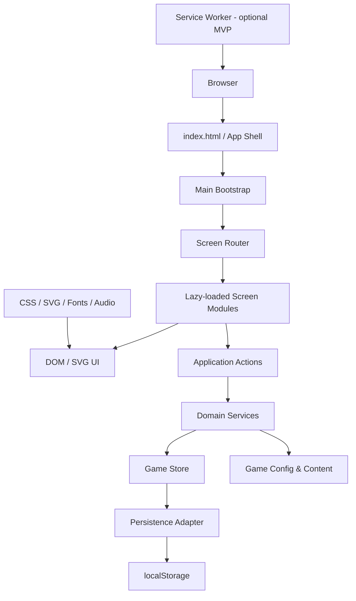
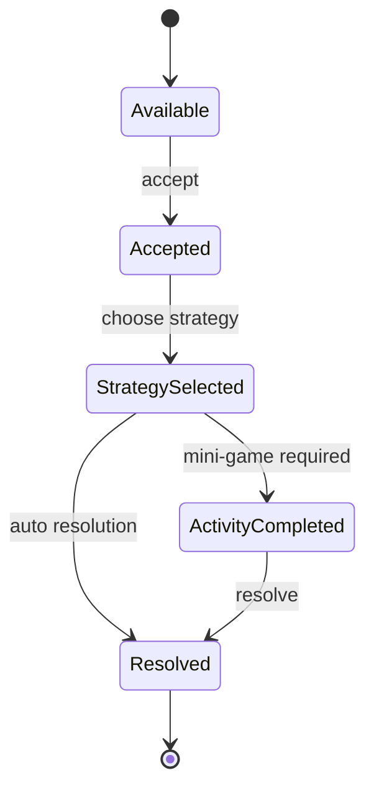

# TECHNICAL SPECIFICATION (TECH SPEC)
# MENJADI BUZZER — v1.0

> Status: Draft untuk implementasi MVP  
> Dokumen acuan: Brainstorm Menjadi Buzzer, GDD Idle Revision v1.0–v1.3, dan PRD Menjadi Buzzer v1.0  
> Referensi arsitektur: hasil analisis REA terhadap `https://tapakrun.appcademy.app/` pada 25 November 2026  
> Target: browser game 2D berbasis web, client-first, dapat dikembangkan menjadi PWA

---

## 1. TUJUAN DOKUMEN

Dokumen ini menetapkan rancangan teknis Menjadi Buzzer: stack, struktur source code, arsitektur frontend, sistem layar, game state, domain logic, penyimpanan, build, PWA, pengujian, dan batas implementasi.

Tech Spec ini menerjemahkan kebutuhan produk dan desain game menjadi arahan teknis yang dapat diikuti developer maupun AI coding agent.

### 1.1 Urutan sumber kebenaran

Jika terdapat perbedaan informasi, gunakan urutan berikut:

1. **Brainstorm** — sumber ide orisinal dan fondasi konsep. Dokumen ini tidak boleh diubah oleh agent.
2. **GDD** — sumber aturan dan desain gameplay.
3. **PRD** — sumber kebutuhan produk, ruang lingkup, dan acceptance criteria.
4. **Tech Spec ini** — sumber keputusan dan kontrak implementasi teknis.

Tech Spec tidak boleh mengubah konsep gameplay yang telah ditetapkan GDD/PRD. Jika ada kebutuhan teknis yang belum diputuskan, tandai sebagai `OPEN DECISION` dan jangan mengarang keputusan produk.

### 1.2 Tujuan arsitektur

- Mengikuti pola arsitektur frontend yang teramati pada TapakRun: Vite, JavaScript/TypeScript, vanilla DOM, inline SVG, CSS, pemisahan layar berbasis dynamic import, dan localStorage.
- Menjaga game ringan dan responsif tanpa Canvas/WebGL maupun framework UI.
- Memisahkan UI, game state, domain logic, data konten, dan persistence.
- Membuat sistem campaign dan ekonomi deterministik untuk bagian perhitungan, dengan random outcome yang disimpan agar tidak berubah setelah refresh.
- Memungkinkan penambahan fitur lanjutan tanpa membangun ulang fondasi MVP.

---

## 2. DASAR ANALISIS ARSITEKTUR TAPAKRUN

Bagian ini membedakan hasil observasi REA dari keputusan implementasi Menjadi Buzzer.

### 2.1 Hasil observasi REA

Analisis terhadap TapakRun menyimpulkan:

| Area | Hasil analisis TapakRun | Keyakinan pada laporan REA |
|---|---|---:|
| Bahasa bundle | JavaScript modern / ES2022; source TypeScript diinferensikan dari konfigurasi Vite | 99% JS bundle / 85% TS source |
| UI framework | Tidak terdeteksi framework UI; vanilla JavaScript | 97% |
| Renderer | DOM, inline SVG, dan CSS | 98% |
| Build tool | Vite | 99% |
| Router | Router buatan sendiri dengan atribut `data-screen` dan dynamic `import()` per layar | 95% |
| State lokal | `localStorage` bernamespace dan berversi | 90% |
| Offline queue | Pola outbox untuk pengiriman data tertunda | 90% |
| PWA | Web manifest dan service worker dengan precache | 99% |
| Backend | Endpoint PHP di `/api/` teramati dari client | 95% PHP |
| Server hosting | Header mengindikasikan LiteSpeed/OpenLiteSpeed, CyberPanel, Cloudflare | sesuai observasi header |
| Database | Tidak terlihat dari client; MySQL/MariaDB hanya inferensi berkeyakinan rendah | 40% |

Catatan penting:
- REA menganalisis artefak browser, bundle, HTTP response, dan DOM; bukan source code asli.
- Nama folder, nama modul, dan struktur source TapakRun yang disajikan di laporan adalah resep rekonstruksi, bukan bukti bahwa source aslinya identik.
- Database, framework PHP, dan implementasi anti-cheat server tidak dapat dipastikan dari analisis client.
- Tech Spec ini mengikuti pola arsitektur frontend yang teramati, bukan menyalin source code, aset, merek, atau identitas TapakRun.

### 2.2 Pola yang diadopsi

| Pola | Keputusan Menjadi Buzzer |
|---|---|
| Vite build pipeline | ADOPT |
| TypeScript untuk source code | ADOPT |
| Vanilla DOM, tanpa React/Vue/Svelte | ADOPT |
| Factory/helper DOM buatan sendiri | ADOPT |
| DOM + inline SVG + CSS | ADOPT |
| Canvas/WebGL | NOT USED untuk MVP |
| Router `data-screen` + dynamic import | ADOPT |
| Screen contract `mount()` / `unmount()` | ADOPT |
| `localStorage` dengan namespace dan schema version | ADOPT |
| Pemisahan game state dan UI | ADOPT, diperketat |
| PWA manifest + service worker | ADOPT secara bertahap |
| Precache semua aset besar | MODIFY; gunakan precache terpilih |
| Backend PHP | DEFER; tidak diperlukan untuk MVP offline/local |
| Leaderboard / telemetry / outbox | DEFER; tidak masuk MVP |
| i18n literal Melayu sebagai key | NOT ADOPTED; gunakan key stabil jika i18n ditambahkan |

### 2.3 Mengapa vanilla DOM + SVG

Menjadi Buzzer pada MVP utamanya terdiri dari:
- dashboard dan panel statistik,
- kartu akun dan campaign,
- tombol, tab, modal, sheet, dan notifikasi,
- daftar upgrade dan transaksi,
- mini-game sederhana,
- ilustrasi karakter 2D berbasis layer.

Karakteristik tersebut cocok dengan DOM dan SVG. Tidak dibutuhkan game engine Canvas untuk MVP.

Keuntungan:
- rendering UI langsung ke DOM;
- mudah menghubungkan tombol dan event;
- SVG tajam pada berbagai resolusi;
- animasi UI menggunakan CSS;
- bundle runtime lebih kecil karena tidak membawa framework UI;
- screen dapat dimuat sesuai kebutuhan melalui dynamic import.

Batasan:
- tidak ada virtual DOM atau automatic diffing;
- developer bertanggung jawab mengelola lifecycle node dan event listener;
- state harus menjadi sumber kebenaran, bukan membaca isi DOM;
- update DOM perlu dibatasi agar tidak membuat layout thrashing.

### 2.4 Prinsip adaptasi, bukan penyalinan

TapakRun adalah referensi arsitektur teknis. Menjadi Buzzer tetap harus memiliki:
- identitas visual orisinal;
- komponen UI dan ilustrasi sendiri;
- struktur domain sesuai gameplay buzzer;
- data model yang mengikuti kebutuhan Menjadi Buzzer;
- aturan ekonomi, campaign, dan penalti dari GDD/PRD.

---

## 3. KEPUTUSAN STACK TEKNOLOGI

### 3.1 Stack MVP

| Lapisan | Teknologi | Status |
|---|---|---|
| Bahasa source | TypeScript | Required |
| Runtime browser | JavaScript modern (ES modules) | Required |
| Build/dev server | Vite | Required |
| UI | Vanilla TypeScript + DOM API | Required |
| Graphics | Inline SVG + CSS | Required |
| Styling | CSS terpisah per screen/komponen bila relevan | Required |
| Routing | Custom screen router (`data-screen` + dynamic import) | Required |
| State | Centralized typed game store / domain state | Required |
| Persistence | `localStorage` dengan namespace dan schema version | Required |
| Animation | CSS transitions/keyframes; `requestAnimationFrame` hanya jika diperlukan | Required |
| PWA | Web App Manifest + Service Worker | Should Have; implement setelah core game stabil |
| Unit testing | Vitest | Recommended |
| Browser E2E | Playwright | Recommended |
| Backend | Tidak ada untuk MVP | Out of Scope |
| Database | Tidak ada untuk MVP | Out of Scope |

### 3.2 Framework policy

Jangan menambahkan React, Vue, Svelte, Angular, Solid, atau framework UI lain ke MVP.

Jangan menambahkan state-management framework eksternal. Game store sederhana yang typed dan terpusat sudah cukup.

Library kecil boleh ditambahkan hanya jika:
1. kebutuhan nyata tidak dapat dipenuhi dengan browser API atau helper internal secara wajar;
2. ukurannya dan dampaknya dijelaskan;
3. tidak mengganti arsitektur utama tanpa persetujuan.

### 3.3 Runtime target

- Browser desktop modern sebagai target utama.
- Browser mobile modern sebagai target responsive.
- JavaScript ES modules.
- Tidak membutuhkan akun, server, atau koneksi internet untuk core gameplay setelah aset game tersedia.
- Semua aset lokal di-origin aplikasi.
- Tidak menggunakan API media sosial asli.

---

## 4. GAMBARAN ARSITEKTUR

### 4.1 Arsitektur tingkat tinggi



### 4.2 Layer responsibilities

**App Shell**
- menyediakan root DOM;
- menampilkan boot/loading fallback;
- menyiapkan global error handling;
- memasang router dan service worker jika diaktifkan.

**Screen Router**
- memetakan screen ID ke module;
- melakukan dynamic import;
- memasang screen ke `#app`;
- menangani perpindahan screen dan lifecycle.

**Screen Modules**
- merender UI suatu layar;
- menghubungkan event UI ke application actions;
- berlangganan perubahan state yang relevan;
- tidak menyimpan aturan ekonomi atau probabilitas di dalam screen.

**Application Actions**
- menangani use case seperti buy upgrade, accept campaign, choose strategy, resolve campaign;
- memvalidasi prasyarat;
- memanggil domain services;
- menyimpan hasil perubahan.

**Domain Services**
- menghitung passive income;
- menghitung harga dan efek upgrade;
- menghitung campaign performance dan success probability;
- menentukan outcome;
- menerapkan reward, penalty, dan transaksi;
- mengatur state transition campaign.

**Game Store**
- sumber kebenaran state aktif;
- menyediakan read snapshot dan mutation action;
- menjaga update konsisten;
- memicu subscriber UI setelah state berubah.

**Persistence Adapter**
- serialize/deserialize save;
- melakukan schema validation;
- menjalankan migration;
- menyimpan dan memulihkan state.

**Config & Content**
- starting values;
- income formula parameters;
- upgrade definitions;
- campaign templates;
- strategy definitions;
- mini-game parameters;
- penalty configuration.

### 4.3 Sumber kebenaran

- Domain state adalah sumber kebenaran.
- DOM hanya representasi state.
- Jangan membaca saldo, follower, risk, atau status campaign dari teks HTML.
- Jangan menyimpan nilai turunan yang dapat dihitung ulang kecuali dibutuhkan sebagai snapshot historis.
- Data result campaign yang sudah final harus disimpan sebagai snapshot agar hasil historis tidak berubah ketika config diperbarui.

---

## 5. STRUKTUR FOLDER DAN FILE

Struktur awal yang direkomendasikan:

```text
menjadi-buzzer/
├── index.html
├── package.json
├── package-lock.json
├── tsconfig.json
├── vite.config.ts
├── public/
│   ├── favicon.svg
│   ├── manifest.webmanifest
│   ├── icons/
│   ├── fonts/
│   └── images/
├── ui-reference/
│   └── ... screenshot referensi UI dan visual ...
├── src/
│   ├── main.ts
│   ├── app/
│   │   ├── bootstrap.ts
│   │   ├── router.ts
│   │   ├── screen-registry.ts
│   │   ├── context.ts
│   │   ├── lifecycle.ts
│   │   └── error-boundary.ts
│   ├── core/
│   │   ├── dom.ts
│   │   ├── svg.ts
│   │   ├── events.ts
│   │   ├── ids.ts
│   │   ├── clock.ts
│   │   ├── money.ts
│   │   └── result.ts
│   ├── state/
│   │   ├── game-store.ts
│   │   ├── selectors.ts
│   │   ├── actions.ts
│   │   ├── initial-state.ts
│   │   └── subscriptions.ts
│   ├── domain/
│   │   ├── player/
│   │   ├── accounts/
│   │   ├── economy/
│   │   ├── passive-income/
│   │   ├── upgrades/
│   │   ├── campaigns/
│   │   ├── strategy/
│   │   ├── minigames/
│   │   ├── risk/
│   │   ├── penalties/
│   │   └── finance/
│   ├── application/
│   │   ├── player/
│   │   ├── income/
│   │   ├── upgrades/
│   │   ├── campaigns/
│   │   └── finance/
│   ├── data/
│   │   ├── config/
│   │   ├── accounts/
│   │   ├── upgrades/
│   │   ├── campaigns/
│   │   ├── strategies/
│   │   └── minigames/
│   ├── persistence/
│   │   ├── storage-adapter.ts
│   │   ├── save-repository.ts
│   │   ├── save-schema.ts
│   │   ├── migrations.ts
│   │   └── backup.ts
│   ├── screens/
│   │   ├── home/
│   │   │   ├── index.ts
│   │   │   └── home.css
│   │   ├── account-detail/
│   │   ├── automation/
│   │   ├── campaign-board/
│   │   ├── campaign-brief/
│   │   ├── campaign-strategy/
│   │   ├── campaign-minigame/
│   │   ├── campaign-result/
│   │   └── finance/
│   ├── components/
│   │   ├── layout/
│   │   ├── navigation/
│   │   ├── cards/
│   │   ├── buttons/
│   │   ├── modal/
│   │   ├── sheet/
│   │   ├── toast/
│   │   ├── indicators/
│   │   └── icons/
│   ├── art/
│   │   ├── character/
│   │   ├── items/
│   │   └── illustrations/
│   ├── styles/
│   │   ├── tokens.css
│   │   ├── reset.css
│   │   ├── global.css
│   │   ├── layout.css
│   │   └── motion.css
│   ├── audio/
│   └── tests/
├── e2e/
└── README.md
```

### 5.1 Struktur folder rules

- `domain/` tidak boleh mengimpor DOM, CSS, atau screen.
- `application/` mengorkestrasi use case dan memanggil domain.
- `screens/` boleh mengimpor component, application action, dan selector.
- `components/` tidak boleh memiliki aturan bisnis.
- `data/` menyimpan definisi/config statis, bukan state pemain yang sedang berubah.
- `persistence/` menjadi satu-satunya lapisan yang mengakses `localStorage`.
- `core/dom.ts` dan `core/svg.ts` menyediakan helper presentasi umum.
- `ui-reference/` wajib ada di root project dan dipelajari sebelum implementasi UI.

---

## 6. APP SHELL, BOOTSTRAP, DAN DOM

### 6.1 HTML shell

`index.html` menyediakan minimal:

```html
<div id="boot" role="status" aria-live="polite">
  Loading game...
</div>
<div id="app"></div>
<div id="overlay-root"></div>
<div id="toast-root" aria-live="polite"></div>
<script type="module" src="/src/main.ts"></script>
```

Root:
- `#boot`: splash/loading dan fallback jika bootstrap gagal.
- `#app`: screen aktif.
- `#overlay-root`: modal, dialog, bottom sheet.
- `#toast-root`: toast/notifikasi sementara.

Overlay dipisahkan dari `#app` agar pergantian screen tidak menghapus modal/toast secara tidak sengaja.

### 6.2 Bootstrap flow

1. Browser memuat HTML shell.
2. `main.ts` memanggil bootstrap.
3. Inisialisasi konfigurasi runtime.
4. Load save melalui persistence repository.
5. Validasi dan migrate save.
6. Jika belum ada save, buat initial state.
7. Buat application context.
8. Daftarkan global error handlers.
9. Inisialisasi router.
10. Render screen awal `home`.
11. Hilangkan boot screen.
12. Register service worker hanya jika PWA build diaktifkan.

### 6.3 DOM factory

Buat helper `el()` agar pembuatan DOM konsisten dan mengurangi boilerplate.

Kontrak konseptual:

```ts
type Child = Node | string | number | null | undefined | false;

type ElementProps = Record<
  string,
  string | number | boolean | EventListener | null | undefined
>;

export function el<K extends keyof HTMLElementTagNameMap>(
  tag: K,
  props?: ElementProps,
  children?: Child | Child[]
): HTMLElementTagNameMap[K];
```

Perilaku helper:
- membuat node dengan `document.createElement`;
- menerapkan atribut/properti;
- `on*` function dipasang melalui `addEventListener`;
- `class` ditangani sebagai `className`;
- text dimasukkan dengan `textContent`;
- children di-append sebagai Node/text;
- tidak mengubah string dari user/server menjadi HTML mentah.

**Security rule:** jangan menyediakan shortcut `html: string` untuk konten dinamis. Jika memang membutuhkan SVG/HTML statis, bangun melalui DOM API atau template statis yang dikendalikan developer. Hindari `innerHTML` untuk data pemain, campaign, atau konten eksternal.

### 6.4 Event lifecycle

- Setiap screen memiliki lifecycle `mount()` dan `unmount()`.
- Event listener screen harus dilepas saat screen dihancurkan.
- Gunakan `AbortController` per screen untuk mengelola event listener jika sesuai.
- Hindari global event listener yang terdaftar berulang setiap navigasi.
- Hindari inline `onclick` string.

---

## 7. SCREEN ROUTER DAN LAZY LOADING

### 7.1 Screen contract

```ts
export interface ScreenContext {
  store: GameStore;
  actions: GameActions;
  navigate: (screenId: ScreenId, params?: Record<string, string>) => void;
  overlays: OverlayService;
  toasts: ToastService;
}

export interface ScreenModule {
  id: ScreenId;
  mount(root: HTMLElement, ctx: ScreenContext, params?: Record<string, string>): void;
  unmount?(): void;
}
```

### 7.2 Screen ID MVP

| Screen ID | Module | Keterangan |
|---|---|---|
| `home` | `screens/home` | Business Home |
| `account-detail` | `screens/account-detail` | Statistik akun |
| `automation` | `screens/automation` | Upgrade dan automation |
| `campaign-board` | `screens/campaign-board` | Daftar kontrak |
| `campaign-brief` | `screens/campaign-brief` | Detail kontrak |
| `campaign-strategy` | `screens/campaign-strategy` | Strategi dan risiko |
| `campaign-minigame` | `screens/campaign-minigame` | Aktivitas interaktif |
| `campaign-result` | `screens/campaign-result` | Hasil campaign |
| `finance` | `screens/finance` | Saldo dan riwayat transaksi |

### 7.3 Router registry

Gunakan registry eksplisit agar bundler dapat menganalisis dynamic import:

```ts
const screenLoaders = {
  home: () => import("../screens/home"),
  "account-detail": () => import("../screens/account-detail"),
  automation: () => import("../screens/automation"),
  "campaign-board": () => import("../screens/campaign-board"),
  "campaign-brief": () => import("../screens/campaign-brief"),
  "campaign-strategy": () => import("../screens/campaign-strategy"),
  "campaign-minigame": () => import("../screens/campaign-minigame"),
  "campaign-result": () => import("../screens/campaign-result"),
  finance: () => import("../screens/finance")
} satisfies Record<ScreenId, () => Promise<{ default: ScreenModule }>>;
```

Contoh di atas adalah kontrak pola; sesuaikan export module secara konsisten.

### 7.4 Navigation lifecycle

Saat berpindah layar:
1. validasi screen ID;
2. simpan state domain yang sudah dimutasi melalui action terkait;
3. panggil `unmount()` screen sebelumnya;
4. abort listener screen sebelumnya;
5. lazy-load screen target;
6. bersihkan `#app`;
7. mount screen baru;
8. update current screen metadata.

Navigasi tidak boleh membuat ulang game state atau menghapus campaign session.

### 7.5 Route parameters

Gunakan parameter sederhana untuk ID entity, misalnya:
- `accountId`
- `campaignId`
- `sessionId`

Jangan menaruh seluruh objek game di parameter router. Screen mengambil data terbaru melalui store selector.

---

## 8. GAME STATE DAN DOMAIN MODEL

### 8.1 Prinsip state

- Satu game save mewakili satu player profile untuk MVP.
- Game state bertipe TypeScript.
- State dimutasi melalui action/domain use case, bukan langsung oleh screen.
- Derived state dihitung melalui selectors.
- Setiap entity memiliki ID stabil.
- Setiap perubahan ekonomi menghasilkan transaction record.
- Campaign session memiliki lifecycle eksplisit.
- Random roll campaign disimpan sebagai bagian dari result.

### 8.2 Model data konseptual

```ts
type AccountStatus =
  | "normal"
  | "warning"
  | "restricted"
  | "suspended";

type CampaignStatus =
  | "available"
  | "accepted"
  | "strategy_selected"
  | "activity_completed"
  | "resolved"
  | "cancelled";

interface PlayerState {
  id: string;
  money: number;
  reputation: number;
  careerLevel: number;
  careerXP: number;
  createdAt: number;
}

interface AccountState {
  id: string;
  name: string;
  platformId: string;
  followers: number;
  performance: number;
  reputation: number;
  suspicion: number;
  status: AccountStatus;
  automationLevel: number;
}

interface UpgradeState {
  id: string;
  accountId: string;
  upgradeKey: string;
  level: number;
}

interface CampaignSession {
  id: string;
  campaignDefinitionId: string;
  accountId: string;
  status: CampaignStatus;
  acceptedAt: number;
  selectedStrategyId?: string;
  selectedIntensity?: string;
  miniGameScore?: number;
  resolvedAt?: number;
  result?: CampaignResultSnapshot;
}

interface CampaignResultSnapshot {
  roll: number;
  successProbability: number;
  performanceScore: number;
  outcome: "success" | "partial" | "failure";
  reward: number;
  bonus: number;
  fine: number;
  reputationDelta: number;
  suspicionDelta: number;
}

interface Transaction {
  id: string;
  type:
    | "passive_income"
    | "campaign_reward"
    | "campaign_bonus"
    | "upgrade_purchase"
    | "fine"
    | "recovery_cost";
  amount: number;
  balanceAfter: number;
  sourceId?: string;
  createdAt: number;
  descriptionKey: string;
}

interface GameSave {
  schemaVersion: number;
  player: PlayerState;
  accounts: AccountState[];
  upgrades: UpgradeState[];
  campaignSessions: CampaignSession[];
  transactions: Transaction[];
  activeTime: {
    lastAccrualAt: number;
    fractionalIncome: number;
  };
  settings: {
    soundEnabled: boolean;
    reducedMotion: boolean;
  };
  meta: {
    createdAt: number;
    updatedAt: number;
  };
}
```

Model ini adalah struktur implementasi awal, bukan kewajiban untuk memakai nama field persis. Jangan menambahkan sistem multi-account penuh, staff, agency, saham, properti, kendaraan, travel, atau leaderboard ke MVP hanya karena model konseptual masa depan memerlukannya.

### 8.3 State domains

Pisahkan domain minimal:
- `player`
- `accounts`
- `economy`
- `passiveIncome`
- `upgrades`
- `campaigns`
- `risk`
- `finance`
- `settings`
- `meta`

### 8.4 Derived selectors

Selector minimal:
- `selectBalance(save)`
- `selectPrimaryAccount(save)`
- `selectIncomeRate(save)`
- `selectIncomePreview(save, elapsedMs)`
- `selectAvailableUpgrades(save)`
- `selectCampaignsAvailable(save)`
- `selectActiveCampaignSession(save)`
- `selectAccountRiskSummary(save)`
- `selectRecentTransactions(save, limit)`

Selector harus pure: tidak mengubah state dan tidak menulis ke storage.

---

## 9. GAME STORE DAN ACTION CONTRACT

### 9.1 Store API

Kontrak konseptual:

```ts
interface GameStore {
  getState(): Readonly<GameSave>;
  subscribe(listener: (state: Readonly<GameSave>) => void): () => void;
  dispatch(action: GameAction): ActionResult;
}
```

Implementasi boleh menggunakan immutable update sederhana atau controlled mutation dengan snapshot yang jelas. Yang penting:
- perubahan terpusat;
- subscriber menerima state terbaru;
- screen tidak mengubah nested state secara langsung;
- action invalid tidak boleh meninggalkan state setengah berubah.

### 9.2 Action list MVP

| Action | Tujuan |
|---|---|
| `ACCRUE_PASSIVE_INCOME` | Mengakumulasi income berdasarkan elapsed active time |
| `PURCHASE_UPGRADE` | Validasi saldo dan membeli upgrade |
| `ACCEPT_CAMPAIGN` | Membuat campaign session |
| `SELECT_CAMPAIGN_STRATEGY` | Menyimpan pilihan strategi |
| `COMPLETE_MINIGAME` | Menyimpan skor aktivitas |
| `RESOLVE_CAMPAIGN` | Menghitung dan menyimpan satu hasil final |
| `APPLY_CAMPAIGN_RESULT` | Menerapkan reward/penalty secara idempotent |
| `RECOVER_ACCOUNT` | Memulihkan akun sesuai aturan konfigurasi |
| `RESET_SAVE` | Reset untuk development/testing, dengan konfirmasi UI |

### 9.3 Action result

Gunakan hasil eksplisit:

```ts
type ActionResult<T = void> =
  | { ok: true; value: T }
  | { ok: false; code: string; messageKey: string };
```

Jangan menggunakan `alert()` sebagai mekanisme error normal. Screen menampilkan feedback dari `ActionResult`.

### 9.4 Transaction boundary

Setiap action ekonomi harus bersifat atomik dari sudut pandang aplikasi:
1. validasi prasyarat;
2. hitung hasil;
3. buat next state;
4. tambahkan transaksi;
5. simpan state;
6. emit update.

Jangan mengurangi saldo terlebih dahulu lalu gagal sebelum upgrade/session berhasil dibuat.

---

## 10. PASSIVE INCOME ENGINE

### 10.1 Active-time policy

MVP hanya memperoleh passive income ketika game terbuka. Tidak ada offline earnings.

- Perhitungan berdasarkan elapsed time, bukan jumlah frame.
- Saat aplikasi berjalan, update income secara berkala.
- Saat tab menjadi hidden, catat timestamp dan jangan menjalankan loop visual yang tidak diperlukan.
- Saat tab kembali visible, hitung elapsed active interval sesuai aturan sesi aktif yang disepakati.
- Saat game ditutup, tidak ada income untuk waktu game tertutup.
- Timestamp dan fractional remainder disimpan agar refresh tidak menghilangkan pecahan income yang sudah berjalan.

### 10.2 Clock abstraction

Gunakan `Clock` abstraction agar perhitungan dapat diuji:

```ts
interface Clock {
  now(): number;
}
```

Production implementation menggunakan `Date.now()`. Unit test menggunakan fake clock.

### 10.3 Income calculation

Formula desain GDD/PRD merupakan sumber aturan. Tech Spec tidak mengunci angka balancing.

Kontrak fungsi:

```ts
interface IncomeContext {
  followers: number;
  performance: number;
  automationLevel: number;
  accountStatus: AccountStatus;
}

function calculateIncomeRate(
  context: IncomeContext,
  config: IncomeConfig
): number;

function calculateAccruedIncome(
  incomeRatePerSecond: number,
  elapsedMs: number,
  fractionalRemainder: number
): {
  wholeAmount: number;
  fractionalRemainder: number;
};
```

Ketentuan:
- followers dan performance memengaruhi income;
- automation meningkatkan income rate;
- account status dapat memodifikasi income;
- semua koefisien berada di config;
- tidak menghitung income per animation frame;
- gunakan presisi internal yang cukup dan format angka hanya di UI.

### 10.4 Timer scheduling

- Gunakan interval ringan (misalnya 500–1000 ms) untuk refresh tampilan, bukan sebagai dasar akumulasi.
- Nilai income selalu dihitung dari elapsed timestamp.
- Hindari membuat interval baru setiap screen mount tanpa cleanup.
- Satu `IncomeScheduler` di application lifecycle cukup untuk MVP.

### 10.5 Auto-credit versus claim

PRD menggunakan auto-credit sebagai baseline implementasi, namun mencatat mekanisme ini belum menjadi keputusan desain final. Implementasikan mekanisme income melalui service terpisah agar UX dapat diubah menjadi claim-based tanpa mengganti formula dan timer.

---

## 11. UPGRADE / AUTOMATION SERVICE

### 11.1 Config-driven upgrades

Data upgrade disimpan terpisah dari UI:

```ts
interface UpgradeDefinition {
  id: string;
  titleKey: string;
  descriptionKey: string;
  maxLevel: number;
  baseCost: number;
  costGrowth: number;
  incomeMultiplierPerLevel: number;
}
```

Nilai aktual berasal dari balancing config dan masih perlu playtesting.

### 11.2 Purchase flow

1. UI meminta preview upgrade dari selector/service.
2. Pemain menekan tombol beli.
3. Application action memvalidasi upgrade masih tersedia.
4. Validasi saldo.
5. Hitung biaya dari config.
6. Kurangi saldo.
7. Tambah level upgrade.
8. Catat transaksi `upgrade_purchase`.
9. Simpan save.
10. Update income rate dan UI.

### 11.3 Integrity

- Upgrade level tidak boleh melewati max level.
- Double click tidak boleh membuat dua pembelian tak sengaja.
- Harga dihitung di domain service, bukan dari teks tombol.
- Upgrade yang sudah dibeli tidak boleh hilang saat refresh.

---

## 12. CAMPAIGN ENGINE

### 12.1 Campaign definition vs session

Pisahkan:
- **Campaign Definition:** template statis dari `data/campaigns/`.
- **Campaign Session:** instance kontrak yang diterima pemain dan tersimpan dalam save.

Campaign definition tidak dimutasi ketika pemain menerima kontrak.

### 12.2 Campaign definition contract

```ts
type CampaignInteraction = "auto" | "interactive" | "hybrid";

interface CampaignDefinition {
  id: string;
  titleKey: string;
  briefKey: string;
  category: string;
  difficulty: number;
  baseReward: number;
  maxBonus: number;
  baseSuccessChance: number;
  baseRisk: number;
  interaction: CampaignInteraction;
  allowedStrategies: string[];
  targetPerformance?: number;
  penaltyProfileId: string;
}
```

### 12.3 Campaign lifecycle



Status final (`resolved`) tidak dapat kembali ke status sebelumnya.

### 12.4 Campaign session persistence

Simpan session pada setiap keputusan penting:
- setelah accept;
- setelah strategi dipilih;
- setelah mini-game selesai;
- setelah hasil dihitung;
- setelah reward/penalty diterapkan.

Jika browser refresh pada tahap apa pun, pemain melanjutkan session dari status terakhir yang valid.

### 12.5 Strategy and risk

Strategy modifiers berada di config. Domain service menggabungkan:
- base campaign difficulty;
- account performance;
- reputation/suspicion;
- selected strategy;
- selected intensity;
- mini-game score jika tersedia;
- account status.

Jangan melakukan perhitungan strategi di screen component.

### 12.6 Performance and probability

Pisahkan dua nilai:
- `performanceScore`: kualitas eksekusi yang berasal dari pilihan dan mini-game.
- `successProbability`: probabilitas keberhasilan setelah modifier.

Mini-game dapat memperbaiki performance/odds, tetapi tidak menjamin sukses.

Kontrak:

```ts
interface CampaignResolutionInput {
  campaign: CampaignDefinition;
  account: AccountState;
  strategyId: string;
  intensity: string;
  miniGameScore?: number;
}

interface CampaignResolution {
  performanceScore: number;
  successProbability: number;
  roll: number;
  outcome: "success" | "partial" | "failure";
}
```

### 12.7 Randomness

- Buat satu random roll untuk satu resolution.
- Simpan nilai roll, probability, dan outcome dalam result snapshot.
- Setelah refresh, tampilkan snapshot yang sama.
- Jangan menjalankan random roll ulang ketika membuka result screen.
- Sediakan seeded RNG atau injectable random provider untuk automated test.
- Clamp probability sesuai batas yang ditentukan konfigurasi.
- Jangan mengklaim random outcome aman dari manipulasi client; MVP tidak memiliki server authoritative.

### 12.8 Idempotent resolution

`RESOLVE_CAMPAIGN` harus:
- menolak session yang sudah resolved;
- membuat result snapshot sekali;
- menerapkan reward/penalty sekali;
- membuat transaksi dengan referensi session;
- menandai session resolved;
- menyimpan seluruh perubahan secara konsisten.

Jika result sudah ada, action harus mengembalikan result yang sama, bukan membuat hasil baru.

---

## 13. RISK, PENALTY, DAN FINANCE

### 13.1 Risk domain

Risk/suspicion diproses oleh domain service. UI hanya menampilkan status dan penjelasan.

Faktor yang dapat memengaruhi risk sesuai GDD:
- pilihan strategi dan intensitas;
- tingkat aktivitas/campaign;
- account reputation/performance;
- random outcome;
- status akun sebelumnya.

### 13.2 Account status

MVP dapat mendukung status:
- `normal`
- `warning`
- `restricted`
- `suspended`

Status dan efeknya harus didefinisikan dalam config. Jangan membuat status tambahan tanpa kebutuhan desain.

### 13.3 Penalty application

Penalty service menghitung dan menerapkan:
- fine;
- reputation delta;
- suspicion delta;
- status change;
- income modifier bila status membatasi akun.

Jangan menganggap setiap kegagalan selalu menerapkan semua konsekuensi. Gunakan penalty profile dan severity dari config.

### 13.4 Balance policy

- Uang tidak boleh menjadi `NaN`, `Infinity`, atau nilai non-finite.
- Aturan saldo negatif/utang harus eksplisit. Default MVP: jangan izinkan saldo negatif kecuali PRD/design menetapkannya.
- Jika fine melebihi saldo, jalankan aturan configured fallback; jangan membiarkan nilai saldo rusak.
- Semua perubahan saldo tercatat di ledger transaksi.

### 13.5 Transaction ledger

Transaction history bersifat append-only untuk MVP:
- transaksi lama tidak diedit untuk memperbarui saldo;
- koreksi dilakukan dengan transaksi kompensasi;
- setiap transaksi memiliki ID unik;
- simpan `balanceAfter` untuk audit/debug;
- gunakan integer untuk satuan uang terkecil dalam game bila mata uang tidak membutuhkan pecahan.

---

## 14. PERSISTENCE DAN SAVE FORMAT

### 14.1 Storage choice

Gunakan `localStorage` untuk MVP, sesuai pola TapakRun yang teramati.

Key namespace yang direkomendasikan:

```text
menjadiBuzzer.save.v1
menjadiBuzzer.settings.v1
```

Hindari menyimpan gambar, audio, font, atau base64 asset di localStorage. Aset tetap menjadi file statis.

### 14.2 Save envelope

```ts
interface SaveEnvelope<T> {
  appId: "menjadi-buzzer";
  schemaVersion: number;
  savedAt: number;
  checksum?: string;
  payload: T;
}
```

Checksum bersifat opsional untuk deteksi kerusakan sederhana, bukan fitur keamanan.

### 14.3 Save lifecycle

- Load sekali saat bootstrap.
- Validate struktur dan tipe.
- Migrate schema bila versi lama dikenali.
- Jika belum ada save, buat initial state.
- Persist setelah action penting.
- Debounce hanya untuk perubahan non-kritis.
- Action ekonomi/campaign penting harus persist segera setelah commit.

### 14.4 Migration

Buat migration berurutan:

```ts
type Migration = (oldSave: unknown) => unknown;

const migrations: Record<number, Migration> = {
  // 1: migrateLegacySaveToV1,
};
```

- Jangan menghapus save lama sebelum migrasi berhasil.
- Simpan backup sementara sebelum migration yang mengubah struktur.
- Jika versi save lebih tinggi dari versi aplikasi, tampilkan pesan kompatibilitas dan jangan menimpa otomatis.

### 14.5 Corrupt save recovery

Jika JSON tidak dapat diparse atau schema tidak valid:
1. jangan crash;
2. jangan langsung overwrite save asli;
3. simpan salinan raw value jika memungkinkan;
4. tampilkan recovery UI;
5. tawarkan reset hanya dengan konfirmasi.

### 14.6 Save integrity limits

localStorage bukan database aman:
- pengguna dapat mengedit save melalui DevTools;
- tidak ada anti-cheat authoritative;
- tidak ada cloud backup;
- data dapat hilang jika browser storage dibersihkan.

Batasan ini diterima untuk single-player MVP.

---

## 15. PWA DAN SERVICE WORKER

### 15.1 Scope

PWA bukan prasyarat untuk menyelesaikan gameplay MVP. Core game harus stabil terlebih dahulu, baru service worker ditambahkan.

### 15.2 Manifest

Manifest dapat menyediakan:
- `name`: Menjadi Buzzer;
- `short_name`: Buzzer;
- `start_url`;
- `display: standalone`;
- icons (regular dan maskable);
- theme/background color.

Orientasi jangan dikunci portrait karena target utama juga desktop; gunakan responsive layout kecuali keputusan produk berikutnya menetapkan sebaliknya.

### 15.3 Caching strategy

Adaptasi dari pola TapakRun:
- app shell: precache;
- file asset dengan content hash: cache-first;
- navigation: network-first dengan fallback shell;
- runtime assets: cache sesuai kebutuhan;
- API route (jika kelak ada): jangan cache secara default.

Untuk MVP tanpa backend, tidak ada endpoint API yang perlu diintersep.

### 15.4 Update lifecycle

- Service worker baru menunggu sampai aman diaktifkan.
- Sediakan UI sederhana untuk memuat ulang ketika update tersedia.
- Jangan mengganti versi aplikasi di tengah campaign session tanpa menyimpan state.
- Hapus cache lama berdasarkan prefix aplikasi dan versi cache.

### 15.5 PWA acceptance

- Aplikasi dapat di-install bila browser mendukung.
- App shell dapat dibuka dari cache setelah kunjungan pertama.
- Update tidak merusak save.
- Cache tidak menyimpan data save sebagai asset statis.

---

## 16. ASSET, CHARACTER, DAN SVG RENDERING

### 16.1 Character renderer

Jika karakter 2D modular digunakan:
- gunakan SVG layer terpisah;
- layer dasar: body/base, hair, clothing, accessory, footwear bila desain membutuhkannya;
- urutan layer ditentukan oleh renderer;
- item karakter direferensikan dengan ID;
- jangan menyimpan SVG markup besar di save;
- save hanya menyimpan ID item yang dipakai.

### 16.2 SVG rules

- SVG harus scalable dan dapat diberi CSS class.
- Hindari SVG yang terlalu kompleks untuk ikon kecil.
- Gunakan `viewBox`.
- Gunakan symbol/use atau sprite jika membantu reuse.
- SVG eksternal dapat dipakai sebagai asset; inline SVG dipakai untuk bagian yang membutuhkan warna/pose dinamis.
- Hindari memasukkan konten user sebagai SVG markup.

### 16.3 Asset organization

- `public/images/`: ilustrasi statis.
- `src/art/`: SVG builder/renderer.
- `src/components/icons/`: ikon UI.
- `public/fonts/`: font self-hosted yang lisensinya jelas.

### 16.4 UI reference

Folder wajib:

```text
/ui-reference
```

Sebelum membuat UI, agent wajib:
1. membuka dan mempelajari screenshot yang tersedia;
2. mengidentifikasi pola layout, komponen, hierarki, navigasi, warna, bentuk, dan feedback;
3. menerapkan bahasa visual yang relevan secara orisinal;
4. tidak menyalin karakter, logo, aset, nama, atau identitas TapakRun maupun Idle Warung Nusantara.

Jika folder tidak tersedia, laporkan dan minta referensi; jangan mengklaim sudah mempelajarinya.

---

## 17. CSS, RESPONSIVE, DAN ANIMATION

### 17.1 CSS architecture

- `tokens.css`: warna, spacing, radius, shadow, typography, z-index.
- `reset.css`: normalize/reset.
- `global.css`: body, root, base typography.
- `layout.css`: app shell, navigation, grid/flex layouts.
- `motion.css`: keyframes dan reduced-motion rules.
- Screen CSS: gaya khusus layar.
- Component CSS: gaya komponen reusable jika diperlukan.

### 17.2 Responsive

- Desktop-first, tetapi bukan desktop-only.
- Gunakan CSS Grid/Flexbox.
- Hindari fixed width yang menyebabkan overflow.
- Panel dapat berubah menjadi stacked layout pada viewport kecil.
- Navigation dapat berubah bentuk untuk mobile.
- Mini-game harus mendukung pointer dan touch.

### 17.3 Animation

- Gunakan CSS transitions/keyframes untuk feedback UI.
- Gunakan `transform` dan `opacity` untuk animasi yang sering terjadi.
- Hindari animasi layout properties bila tidak perlu.
- Gunakan `requestAnimationFrame` hanya untuk interaksi yang memang memerlukan frame loop.
- Hormati `prefers-reduced-motion`.
- Jangan menjalankan loop animasi ketika tab tidak terlihat.

### 17.4 Layout measurement

Jangan memanggil `getBoundingClientRect()` berulang di loop animasi. Simpan posisi pada model bila memungkinkan. Jika pengukuran DOM diperlukan:
- batch read sebelum write;
- jalankan saat resize/interaction;
- gunakan ResizeObserver jika sesuai;
- hindari forced synchronous layout.

---

## 18. MINI-GAME TECHNICAL DESIGN

### 18.1 MVP boundary

MVP mengimplementasikan satu mini-game sederhana yang dapat dipilih dari kandidat GDD/PRD setelah keputusan desain final. Tech Spec tidak mengunci nama atau mekanik mini-game tertentu.

### 18.2 Mini-game contract

```ts
interface MiniGameResult {
  score: number;
  grade?: string;
  durationMs: number;
  completedAt: number;
}

interface MiniGameModule {
  mount(root: HTMLElement, context: MiniGameContext): void;
  start(): void;
  pause(): void;
  resume(): void;
  finish(): MiniGameResult;
  destroy(): void;
}
```

### 18.3 Rules

- Mini-game berjalan di DOM/SVG, bukan Canvas untuk MVP.
- Input mendukung mouse dan touch.
- Timer menggunakan elapsed timestamp, bukan frame count.
- Pause/visibility handling harus mencegah timer berjalan tidak konsisten.
- Skor disimpan ke campaign session setelah selesai.
- Refresh setelah selesai tidak boleh mengulang mini-game untuk memperoleh skor baru pada session yang sama.
- Mini-game tidak menentukan hasil campaign secara langsung; hasil tetap melalui campaign resolution service.

---

## 19. AUDIO DAN FEEDBACK

Audio bukan blocker MVP.

Jika ditambahkan:
- gunakan Web Audio API atau file audio lokal;
- lazy-load audio module;
- jangan autoplay audio sebelum interaksi pengguna jika browser melarang;
- sediakan mute toggle;
- simpan pengaturan audio di settings key;
- suara harus punya fungsi feedback, bukan sekadar terus-menerus berjalan.

Feedback UI minimal:
- toast untuk transaksi dan perubahan state;
- modal untuk keputusan penting;
- disabled state untuk aksi invalid;
- result panel untuk hasil campaign;
- visual risk indicator untuk keputusan berisiko.

---

## 20. PERFORMANCE BUDGET

Target awal (bukan hasil benchmark):
- entry JS idealnya di bawah 250 KB compressed/uncompressed sesuai cara pengukuran yang dipakai tim; catat metrik secara konsisten.
- initial screen tidak perlu memuat seluruh screen module.
- screen module di-load on demand.
- asset berat tidak dimasukkan ke entry bundle.
- tidak ada rendering per frame untuk dashboard statis.
- income update menggunakan timer ringan dan elapsed calculation.
- hindari library besar untuk kebutuhan yang dapat diselesaikan native.

Pengukuran wajib:
- Vite build output;
- ukuran entry chunk;
- ukuran setiap screen chunk;
- initial load;
- navigasi antar-screen;
- memory/listener leak setelah navigasi berulang.

Angka TapakRun (entry sekitar 203 KB, chunk screen sekitar 433 KB, registry sekitar 610 KB menurut analisis REA) adalah referensi pembanding, bukan target wajib atau jaminan performa.

---

## 21. ERROR HANDLING DAN LOGGING

### 21.1 Error categories

- bootstrap/load error;
- screen import/render error;
- save parse/validation error;
- persistence quota/error;
- invalid domain action;
- campaign configuration error;
- mini-game runtime error.

### 21.2 User-facing behavior

- tampilkan pesan yang dapat dipahami;
- jangan tampilkan stack trace kepada pemain;
- sediakan retry jika operasi dapat diulang dengan aman;
- jangan mengulang transaksi secara otomatis;
- jangan menghapus save karena error screen;
- error penting dicatat di console pada development.

### 21.3 Development diagnostics

Boleh menyediakan debug panel atau console helpers untuk:
- melihat schema version;
- melihat player/account state;
- mengubah waktu melalui fake clock pada test;
- memilih seeded RNG;
- mengaktifkan campaign fixture success/failure.

Debug controls tidak boleh aktif pada production build tanpa opt-in eksplisit.

---

## 22. SECURITY DAN PRIVACY

### 22.1 MVP

- Tidak ada login.
- Tidak ada pengumpulan data pribadi.
- Tidak meminta password atau token akun media sosial.
- Tidak terhubung ke platform sosial asli.
- Tidak ada secret/API key pada client.
- Semua nama brand, akun, klien, tokoh, dan campaign menggunakan entitas fiktif sesuai GDD.

### 22.2 Client-side limitations

Karena MVP single-player dan local-first:
- state dapat diedit oleh pemain;
- random result dapat dimanipulasi melalui DevTools;
- localStorage bukan penyimpanan tepercaya;
- tidak ada leaderboard yang dapat dipercaya.

Jangan menyebut sistem ini anti-cheat. Jika leaderboard, kompetisi, cloud save, atau transaksi lintas pemain ditambahkan kelak, diperlukan backend authoritative.

---

## 23. BACKEND DAN ROADMAP SERVER

### 23.1 Keputusan MVP

**Tidak membangun backend untuk MVP.**

Alasan:
- PRD secara eksplisit menempatkan backend, login, cloud save, multiplayer, dan leaderboard di luar scope MVP.
- Gameplay inti dapat berjalan secara local-first.
- Backend tidak diperlukan untuk passive income, upgrade, campaign, result, dan finance history single-player.

### 23.2 Referensi backend TapakRun

Analisis REA mengamati endpoint PHP:
- `/api/leaderboard.php`
- `/api/news.php`
- `/api/stats.php`

Laporan juga mengamati JSON envelope `{success, data, error}`, validasi Origin pada endpoint stats, dan outbox client-side.

Informasi tersebut adalah observasi TapakRun, bukan kewajiban Menjadi Buzzer. Jangan membuat endpoint tersebut untuk MVP hanya demi meniru jumlah endpoint.

### 23.3 Backend future option

Jika kebutuhan online disetujui di masa depan:
- buat API boundary terpisah dari domain logic;
- server menjadi authoritative untuk leaderboard dan hasil kompetitif;
- validasi transaksi dan score di server;
- gunakan request schema validation;
- rate-limit endpoint;
- gunakan idempotency key;
- jangan mempercayai score atau money yang dikirim client;
- pertimbangkan PHP API jika ingin mengikuti pola backend TapakRun, tetapi pemilihan framework/database harus menjadi keputusan terpisah berdasarkan hosting dan kebutuhan.

Tidak ada keputusan final tentang PHP framework atau database untuk Menjadi Buzzer.

---

## 24. TESTING STRATEGY

### 24.1 Unit tests

Uji pure domain functions:
- income rate;
- elapsed time accrual;
- fractional remainder;
- upgrade cost/effect;
- campaign performance score;
- success probability;
- outcome resolver;
- penalty profile;
- transaction balance;
- save schema migration.

### 24.2 Integration tests

Uji alur:
- bootstrap dari save kosong;
- load save valid;
- purchase upgrade + transaction;
- accept campaign;
- select strategy;
- complete mini-game;
- resolve campaign;
- apply reward/penalty;
- reload save;
- open campaign result tanpa double reward.

### 24.3 E2E tests

Skenario minimal:
1. first launch → Home;
2. passive income bertambah saat tab aktif;
3. upgrade dapat dibeli;
4. saldo kurang → purchase ditolak;
5. campaign diterima dan diselesaikan;
6. refresh di tengah campaign → session pulih;
7. refresh pada result → reward tidak dobel;
8. finance history mencatat transaksi;
9. mobile viewport tidak overflow;
10. navigasi berulang tidak menggandakan event handler.

### 24.4 Deterministic tests

- Gunakan fake clock untuk passive income.
- Gunakan seeded/injected random provider untuk campaign resolution.
- Sediakan fixtures untuk forced success, partial, dan failure.
- Jangan bergantung pada random real saat automated tests.

---

## 25. BUILD, DEV, DAN DEPLOYMENT

### 25.1 Scripts

Rekomendasi `package.json` scripts:

```json
{
  "scripts": {
    "dev": "vite",
    "build": "tsc -b && vite build",
    "preview": "vite preview",
    "test": "vitest run",
    "test:watch": "vitest",
    "test:e2e": "playwright test"
  }
}
```

Sesuaikan command dengan konfigurasi TypeScript aktual. Jangan menambahkan script untuk tool yang belum dipasang.

### 25.2 Vite config

- `base` harus disesuaikan dengan lokasi deployment (root domain atau subpath).
- output build berada di `dist/` kecuali deployment target memerlukan nama lain.
- gunakan content hash untuk asset production.
- aktifkan source map hanya sesuai kebutuhan deployment/debugging.
- pisahkan screen modules melalui dynamic imports.
- jangan mengubah nama output menjadi `dist-tapak/` kecuali memang ada alasan deployment; nama tersebut adalah detail proyek TapakRun.

### 25.3 Deployment

MVP dapat dideploy sebagai static site:
- hasil `vite build`;
- upload isi folder build ke static hosting;
- pastikan SPA/screen fallback tidak diperlukan bila router internal tidak menggunakan URL path;
- jika menggunakan query/hash untuk deep link, dokumentasikan perilakunya;
- gunakan HTTPS untuk PWA/service worker.

Backend tidak diperlukan untuk static deployment MVP.

---

## 26. IMPLEMENTATION PHASES

### Phase 0 — Repository Foundation
- Vite + TypeScript setup.
- HTML app shell.
- DOM factory.
- SVG helper dasar.
- CSS tokens/reset.
- Error fallback.
- Folder `/ui-reference` diverifikasi.

### Phase 1 — App Architecture
- Game state types.
- Initial state.
- Store dan selectors.
- Persistence adapter.
- Save schema/version.
- Screen contract.
- Router + lazy loading.

### Phase 2 — Passive Management
- Business Home.
- Account Detail.
- Income engine.
- Active-time tracking.
- Finance transaction ledger.

### Phase 3 — Automation
- Upgrade config.
- Upgrade screen.
- Purchase validation.
- Income recalculation.

### Phase 4 — Campaign Foundation
- Campaign definitions.
- Campaign Board.
- Campaign Brief.
- Campaign session lifecycle.
- Strategy selection.

### Phase 5 — Campaign Resolution
- Mini-game module (satu jenis untuk MVP).
- Performance/probability resolver.
- Result snapshot.
- Reward/penalty application.
- Finance integration.

### Phase 6 — Reliability & Polish
- Save recovery.
- Responsive UI.
- Accessibility/reduced motion.
- Unit/integration/E2E tests.
- Performance review.
- PWA bila disetujui dan core sudah stabil.

Jangan mulai fitur shop, stocks, property, vehicles, travel, photo mode, multi-account network, staff, agency, leaderboard, atau online systems dalam MVP kecuali scope PRD diubah.

---

## 27. AI CODING AGENT RULES

Agent yang mengimplementasikan proyek wajib:

1. Membaca Brainstorm, GDD, PRD, dan Tech Spec sebelum coding.
2. Tidak mengubah Brainstorm.
3. Mempelajari seluruh screenshot yang tersedia di `/ui-reference` sebelum membuat UI.
4. Mengikuti vanilla TypeScript + DOM + inline SVG + CSS; tidak menambahkan framework UI.
5. Menggunakan Vite sebagai build tool.
6. Memakai screen router dan dynamic import sesuai kontrak.
7. Memisahkan domain logic dari UI.
8. Menjadikan game store sebagai sumber kebenaran.
9. Mengakses localStorage hanya melalui persistence layer.
10. Menyimpan schema version dan menyediakan migration path.
11. Menggunakan elapsed time, bukan frame count, untuk income dan timer.
12. Menyimpan random roll campaign dan result snapshot.
13. Mencegah double transaction, double reward, dan double penalty.
14. Menjaga campaign session tetap ada saat navigasi atau refresh.
15. Tidak membangun backend/login/cloud save/leaderboard untuk MVP.
16. Tidak mengarang nilai balancing final; gunakan config placeholder yang jelas.
17. Tidak menyalin source, asset, nama, atau identitas TapakRun.
18. Menulis test untuk formula dan state transition yang penting.
19. Menjaga file tetap modular dan tidak membuat satu file raksasa.
20. Melaporkan keputusan yang belum jelas sebagai open decision, bukan mengambil keputusan produk diam-diam.

### 27.1 Larangan arsitektur

- Jangan menambahkan React/Vue/Svelte.
- Jangan memakai Canvas/WebGL untuk menggambar dashboard atau karakter MVP.
- Jangan meletakkan formula ekonomi/probability di screen.
- Jangan menaruh data statis campaign di dalam komponen UI.
- Jangan menulis localStorage dari banyak modul.
- Jangan memakai `innerHTML` untuk data dinamis.
- Jangan menggunakan random resolver saat membuka result screen.
- Jangan membuat backend sebelum ada perubahan scope.
- Jangan mengimplementasikan fitur out-of-scope hanya karena mudah dibuat.

---

## 28. ACCEPTANCE CRITERIA TEKNIS

Tech Spec dianggap terimplementasi dengan benar bila:

### Architecture
- [ ] Vite + TypeScript berjalan.
- [ ] UI memakai vanilla DOM, SVG, dan CSS.
- [ ] Tidak ada framework UI.
- [ ] Screen modules di-lazy-load.
- [ ] Screen contract memiliki lifecycle yang jelas.
- [ ] Domain logic tidak bergantung pada DOM.

### State and persistence
- [ ] Satu typed game store menjadi sumber kebenaran.
- [ ] Persistence terpusat.
- [ ] Save memiliki schema version.
- [ ] Save dapat dimuat setelah refresh.
- [ ] Corrupt save ditangani tanpa silent overwrite.
- [ ] Migration path tersedia.

### Gameplay systems
- [ ] Income dihitung dari elapsed active time.
- [ ] Offline earnings tidak diberikan.
- [ ] Upgrade diproses secara atomik.
- [ ] Campaign memiliki lifecycle state.
- [ ] Strategy dan mini-game memengaruhi resolusi.
- [ ] Random roll dan result snapshot disimpan.
- [ ] Reward/penalty idempotent.
- [ ] Transaction ledger konsisten.

### UI and performance
- [ ] Semua screen MVP tersedia.
- [ ] `/ui-reference` dipelajari sebelum implementasi UI.
- [ ] Responsive desktop/mobile.
- [ ] Reduced-motion dihormati.
- [ ] Tidak ada interval/listener bocor setelah navigasi.
- [ ] Entry bundle dan screen chunks diukur.

### Scope
- [ ] Tidak ada backend untuk MVP.
- [ ] Tidak ada login/cloud save/leaderboard.
- [ ] Tidak ada integrasi media sosial asli.
- [ ] Fitur out-of-scope tidak dibangun.

---

## 29. OPEN DECISIONS / ASSUMPTIONS

Daftar ini harus diperbarui ketika keputusan produk disetujui.

| ID | Topik | Kondisi | Aturan sementara |
|---|---|---|---|
| TD-001 | Passive income UX | Belum final antara auto-credit dan claim | Service dibuat terpisah; PRD baseline auto-credit |
| TD-002 | Mini-game MVP | Jenis mini-game belum final | Implementasikan satu mini-game setelah dipilih |
| TD-003 | Currency precision | Format mata uang final belum dikunci | Gunakan integer internal bila memungkinkan |
| TD-004 | Fine lebih besar dari saldo | Aturan utang/penyitaan belum final | Jangan membuat saldo negatif tanpa config |
| TD-005 | PWA timing | Bukan blocker gameplay | Implementasi setelah core stabil |
| TD-006 | Future backend | Belum masuk MVP | Tidak membuat API/database saat ini |
| TD-007 | URL navigation | Deep-link belum ditentukan | Router internal screen ID, URL path opsional |
| TD-008 | i18n | Bahasa MVP belum difinalisasi | Gunakan string dictionary/key yang mudah dipisah; jangan meniru literal Melayu key TapakRun |

Jangan menyelesaikan open decision dengan asumsi tersembunyi. Catat keputusan baru di Tech Spec dan, jika berdampak ke gameplay, sinkronkan GDD/PRD.

---

## 30. CHANGE LOG

| Versi | Tanggal | Perubahan |
|---|---|---|
| v1.0 | 2026-11-26 | Dokumen Tech Spec pertama berdasarkan Brainstorm, GDD Idle Revision v1.0–v1.3, PRD v1.0, dan hasil analisis REA TapakRun. |

---

## 31. REFERENSI DOKUMEN

- `brainstorm.md` — ide orisinal dan analisis REA TapakRun; immutable.
- `GDD-v1.0-Idle-Revision.md` — game overview dan high-level design.
- `GDD-v1.1-Idle-Revision.md` — idle systems, accounts, income, campaign, risk.
- `GDD-v1.2-Idle-Revision.md` — gameplay mechanics dan formula contracts.
- `GDD-v1.3-Idle-Prototype-Spec.md` — prototype screens, state, acceptance.
- `PRD-Menjadi-Buzzer-v1.0.md` — product requirements dan MVP acceptance.
- `/ui-reference/` — screenshot referensi visual/UI yang wajib dipelajari sebelum implementasi UI.

**Catatan:** nama file referensi di atas mengikuti nama dokumen yang diharapkan di repository. Jika nama aktual berbeda, perbarui daftar referensi tanpa mengubah isi dokumen sumber.
