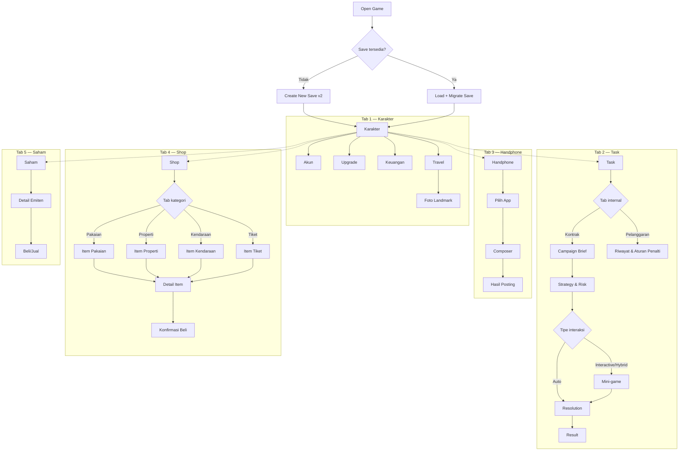

# UI FLOW — MENJADI BUZZER v2.0

**Versi:** 2.0 (selaras PRD v2.0: 5 menu)
**Status:** Draft
**Platform:** Browser Game · Single-player · Semi Idle

## 1. Tujuan

Menetapkan hubungan navigasi dan urutan interaksi antarlayar untuk struktur 5 menu.

## 2. Prinsip Navigasi

- **Lima tab utama** selalu tersedia: Karakter, Task, Handphone, Shop, Saham.
- Karakter adalah titik pusat (hub) untuk identitas, akun, upgrade, keuangan, travel.
- Handphone adalah pusat aktivitas posting.
- Task adalah pusat kontrak kampanye dan pelanggaran.
- Berpindah tab/layar tidak menghapus campaign session, draft posting, atau state saham.
- Campaign yang diterima dapat dilanjutkan setelah refresh.
- Result yang sudah resolved dapat dibuka ulang tanpa menerapkan reward ulang.
- Jangan menampilkan menu palsu yang terlihat aktif tapi tidak berfungsi.

## 3. Struktur Navigasi

## 4. Daftar Screen ID

| Screen ID | Nama | Tab | Akses |
|---|---|---|---|
| `character` | Karakter | Karakter | Entry point |
| `account-detail` | Akun | Karakter | Karakter |
| `automation` | Upgrade | Karakter | Karakter / Akun |
| `finance` | Keuangan | Karakter | Karakter / Result |
| `travel` | Travel | Karakter | Karakter |
| `photo` | Foto Landmark | Karakter | Travel |
| `task` | Task | Task | Nav |
| `violations` | Pelanggaran | Task | Task (tab) |
| `campaign-brief` | Campaign Brief | Task | Task |
| `campaign-strategy` | Strategy & Risk | Task | Brief / resume |
| `campaign-minigame` | Interactive Activity | Task | Strategy |
| `campaign-result` | Campaign Result | Task | Resolution / history |
| `handphone` | Handphone | Handphone | Nav |
| `composer` | Composer | Handphone | Handphone |
| `post-result` | Hasil Posting | Handphone | Composer |
| `shop` | Shop | Shop | Nav |
| `shop-detail` | Detail Item | Shop | Shop |
| `stocks` | Saham | Saham | Nav |
| `stock-detail` | Detail Emiten | Saham | Saham |

## 5. Flow Detail

### 5.1 First Launch

1. Bootstrap memeriksa save.
2. Tidak ada → buat state v2 lengkap (player, akun, karakter + outfit default, inventory, aset kosong, tiket kosong, saham awal, social default, violations kosong, risk safe).
3. Ada v1 → backup → migrasi ke v2 → validasi.
4. Gagal → recovery UI, jangan timpa.
5. Tampilkan Karakter.

### 5.2 Siklus Posting (Handphone)

1. Pemain buka tab Handphone.
2. Pilih app (Chirper/Pulse/Loop).
3. Tekan Posting → composer.
4. Pilih caption, hashtag, jam.
5. Preview estimasi kualitatif.
6. Posting → hasil (engagement, followers, uang, suspicion).
7. Bila suspicion melewati threshold → tier naik → notifikasi konsekuensi.
8. Cooldown aktif; tombol Posting disabled dengan sisa waktu.

### 5.3 Siklus Campaign (Task)

1. Buka tab Task → tab Kontrak.
2. Pilih kontrak eligible.
3. Brief → Accept (membuat session).
4. Strategy & Risk → Confirm.
5. Auto → Resolution; Interactive/Hybrid → Mini-game → Resolution.
6. Result → Karakter atau Keuangan.

### 5.4 Siklus Shop

1. Buka tab Shop.
2. Pilih kategori.
3. Pilih item → detail.
4. Beli (validasi saldo) → item dimiliki.
5. Outfit → pasang di Karakter. Tiket → buka negara di Travel.

### 5.5 Siklus Saham

1. Buka tab Saham.
2. Lihat portofolio ringkas + daftar emiten.
3. Pilih emiten → detail + grafik.
4. Beli/jual dengan jumlah lembar.
5. Portofolio dan Keuangan diperbarui.

### 5.6 Siklus Travel

1. Karakter → Travel.
2. Pilih negara (terkunci bila belum punya tiket).
3. Terbang → lokasi berubah.
4. Foto → preview → unduh PNG.

### 5.7 Resume Setelah Refresh

- Campaign aktif → kembali ke langkah tersimpan.
- Composer dengan draft → draft dipertahankan (bila disimpan).
- Cooldown posting → sisa waktu dipulihkan dari timestamp.
- Harga saham → tidak bergerak untuk waktu tertutup.

## 6. Modal, Dialog, Feedback

Modal untuk:
- Konfirmasi pembelian mahal.
- Konfirmasi keputusan kampanye berisiko.
- Penjelasan aksi disabled.
- Peringatan kenaikan risk tier.
- Error penyimpanan.

Toast untuk:
- Income bertambah (ringkas).
- Upgrade berhasil.
- Posting berhasil.
- Contract accepted.
- Pembelian shop.
- Transaksi saham.
- Denda diterapkan.

## 7. Aturan State Navigasi

| Kondisi | Perilaku |
|---|---|
| Pindah tab saat income berjalan | Income tetap dihitung |
| Pindah layar saat campaign aktif | Session dipertahankan |
| Refresh saat campaign aktif | Resume dari checkpoint |
| Refresh saat cooldown posting | Sisa cooldown dipulihkan |
| Double click beli/posting | Dicegah |
| Result dibuka ulang | Tanpa reward ulang |
| Item tidak eligible | Alasan ditampilkan, aksi disabled |
| Save gagal | Feedback + recovery policy |

## 8. Batas MVP

Tidak termasuk: backend, login, cloud save, multiplayer, leaderboard online, berbagi foto ke pemain lain, agensi/staf, game over permanen, offline earnings.

## 9. Dokumen Terkait

- `../project-requirements/PRD-Menjadi-Buzzer-v2.0.md`
- `../technical-spec/Tech-Spec-Menjadi-Buzzer-v2.0.md`
- `screen-specifications.md`
- `design-system.md`
- `../ui-reference/`
